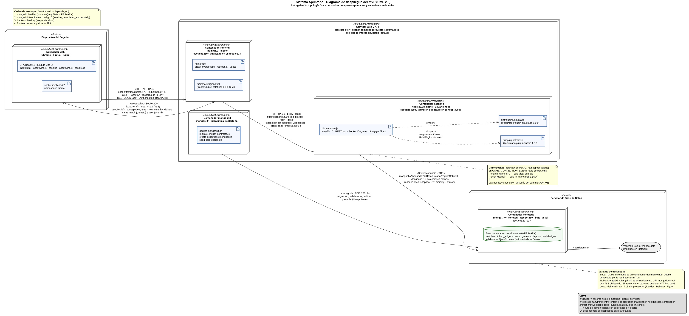
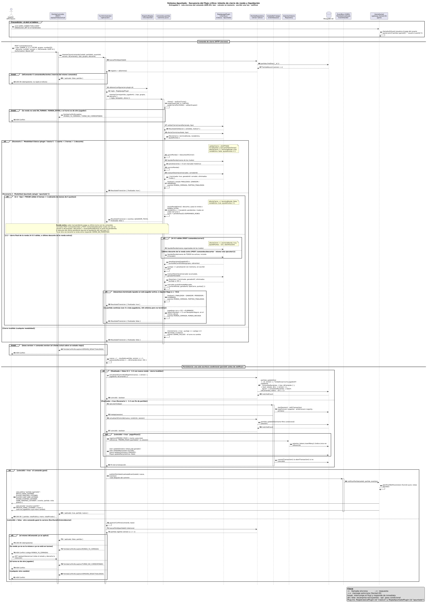
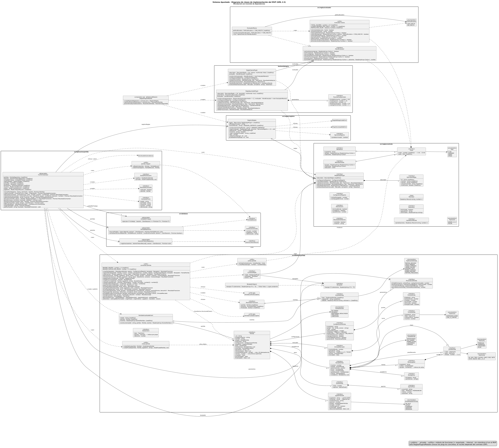

# Capítulo 1. Arquitectura física y dinámica de la solución (modelado UML)

Entregable 3, MVP del Sistema Apuntado. Rama `feature/entregable-3-mvp`.

Este capítulo documenta, con tres diagramas UML 2.5, cómo está desplegado el MVP, cómo se ejecuta
su flujo más delicado y cómo está construido por dentro. Los diagramas se dibujaron a partir del
código y de la configuración de esta rama, no del diseño previo: cada elemento tiene un archivo
fuente identificable. Cuando el MVP difiere del diseño del Entregable 2, la diferencia se explica
en la sección 1.4.

| Sección | Diagrama | Fuente PlantUML | Exportaciones |
|---|---|---|---|
| 1.1 | Despliegue | [`diagramas/entregable-3/01-despliegue-mvp.puml`](../diagramas/entregable-3/01-despliegue-mvp.puml) | `.png` · `.svg` |
| 1.2 | Secuencia del flujo crítico | [`diagramas/entregable-3/02-secuencia-cierre-liquidacion.puml`](../diagramas/entregable-3/02-secuencia-cierre-liquidacion.puml) | `.png` · `.svg` |
| 1.3 | Clases de implementación | [`diagramas/entregable-3/03-clases-implementacion-mvp.puml`](../diagramas/entregable-3/03-clases-implementacion-mvp.puml) | `.png` · `.svg` |

**Convenciones de diagramación** (Richards & Ford, 2025, cap. 23). Cada diagrama tiene título,
una clave (*legend*) que explica su notación y nombres tomados literalmente del código. Se usa
UML 2.5 sin mezclar notaciones: estereotipos `«device»` y `«executionEnvironment»` en el
despliegue, fragmentos combinados `alt`, `opt` y `break` en la secuencia, y visibilidad,
multiplicidades y estereotipos estándar (`«interface»`, `«enumeration»`, `«utility»`) en las clases.
Para el informe conviene usar las versiones `.svg`, que se pueden ampliar sin perder nitidez.

---

## 1.1 Diagrama UML de despliegue

### Propósito

Muestra la topología física sobre la que corre el MVP: qué nodos existen, qué artefactos se
despliegan en cada uno y por qué protocolo y puerto se comunican. Corresponde a la intersección
entre la arquitectura y la infraestructura operativa (Richards & Ford, 2025, caps. 23 y 26).
La fuente de verdad es `docker-compose.yml`, `frontend/nginx.conf` y los dos `Dockerfile`.

### Nodos y artefactos

| Nodo (estereotipo) | Entorno de ejecución | Artefactos desplegados |
|---|---|---|
| **Dispositivo del Jugador** `«device»` | Navegador web `«executionEnvironment»` | SPA React 18 compilada con Vite 5 (`index.html` y `assets/index-[hash].js/.css`) y `socket.io-client` 4.7 conectado al namespace `/game`. |
| **Servidor Web y API** `«executionEnvironment»` | Host Docker con el proyecto `apuntado` de docker compose y la red interna `apuntado_default` | Contiene los tres contenedores de las filas siguientes. |
| Contenedor `frontend` | `nginx:1.27-alpine`, escucha en `:80` y se publica en el host como `:5173` | Estáticos de la SPA en `/usr/share/nginx/html` y `nginx.conf`, que actúa como proxy inverso de `/api/`, `/socket.io/` y `/docs`. |
| Contenedor `backend` | `node:20.18-alpine`, usuario sin privilegios `node`, escucha en `:3000` | `dist/src/main.js` (NestJS 10: REST `/api`, Socket.IO `/game` y Swagger `/docs`) y los plug-ins compilados `dist/plugins/clasica` y `dist/plugins/apuntado`. |
| Contenedor `mongo-init` | `mongo:7.0`, tarea de una sola ejecución (`restart: "no"`) | `init.sh`, `create-collections.mongodb.js` (validadores `$jsonSchema` e índices) y `seed-card-designs.js`. |
| **Servidor de Base de Datos** `«device»` | Contenedor `mongodb` (`mongo:7.0`, `mongod --replSet rs0`, `:27017`) | Base `apuntado` en replica set `rs0` con las colecciones `partidas`, `asientos_tokens`, `User`, `Game`, `Player` y `Card-design`. Persiste en el volumen `mongo-data` montado en `/data/db`. |

### Rutas de comunicación

| Origen → destino | Protocolo y puerto | Qué viaja |
|---|---|---|
| Navegador → Nginx | HTTP en `localhost:5173` (local) · HTTPS en `:443` (nube) | Descarga de la SPA y API REST JSON `/api/*` con `Authorization: Bearer <JWT>`. |
| Navegador ↔ Nginx | WebSocket con Socket.IO: `ws://` en local, `wss://` en la nube | Ruta `/socket.io/`, namespace `/game`, JWT en el *handshake*. Mensajes de las salas `partida:{gameId}` y `usuario:{userId}`. |
| Nginx → backend | HTTP/1.1 por `proxy_pass http://backend:3000` en la red interna | `/api/` y `/docs`; `/socket.io/` con `Upgrade: websocket` y `proxy_read_timeout 3600s`, que mantiene abiertas las conexiones largas. |
| Backend → MongoDB | Driver de MongoDB sobre TCP `:27017`: `mongodb://mongodb:27017/apuntado?replicaSet=rs0` | Mongoose 8 para las colecciones heredadas y el driver nativo para `partidas` y `asientos_tokens`. Transacciones con `readConcern: snapshot`, `writeConcern: majority` y `readPreference: primary`. |
| mongo-init → MongoDB | `mongosh` sobre TCP `:27017` | Validadores, índices y semilla de diseños. Es idempotente: se puede volver a ejecutar sin efectos duplicados. |

### Decisiones que el diagrama hace visibles

1. **Mismo origen.** Nginx sirve la SPA y reenvía `/api` y `/socket.io` al backend. Así el
   navegador nunca hace peticiones entre orígenes distintos, el *bundle* no necesita conocer la
   URL del backend (`VITE_BACKEND_BASE_URL` queda vacío en Docker) y basta un solo certificado TLS.
2. **Replica set obligatorio.** El cobro de apuestas al iniciar y el pago del pozo al terminar
   escriben en varias colecciones a la vez, y eso exige transacciones multidocumento. MongoDB solo
   las admite en un replica set, por eso el MVP local también corre `rs0`, aunque tenga un solo
   nodo (ADR-04).
3. **Arranque ordenado por salud.** La nota del diagrama resume la cadena `healthcheck` +
   `depends_on`: primero MongoDB llega a PRIMARY, después `mongo-init` termina con código 0,
   luego el backend responde `/docs` y por último arranca el frontend. El backend nunca arranca
   contra una base sin validadores.
4. **Salas pública y privada (R04).** Al recibir `GAME_CONNECTION_EVENT`, `GameSocket` une cada
   conexión a dos salas: `partida:{gameId}`, que solo recibe la vista pública, y
   `usuario:{userId}`, que solo recibe la mano propia. El identificador de la sala pública es el
   `gameId` de la sala de espera, que no cambia antes ni durante la partida.
5. **Plug-ins como artefactos separados.** Clásica y Apuntado se compilan como paquetes
   independientes dentro de `dist/plugins/`. En el MVP `ReglasPluginsModule` los registra
   importándolos de forma estática (ver la sección 1.4).

### Variante de despliegue en la nube

El nodo *Servidor de Base de Datos* aparece como un dispositivo aparte porque esa es su función
lógica. En el MVP local es otro contenedor del mismo host Docker, conectado por la red interna sin
TLS. En la nube ese nodo se reemplaza por MongoDB Atlas: el plan M0 ya es un replica set, se accede
con una URI `mongodb+srv://` y TLS es obligatorio. El frontend y el backend se publican en un
proveedor con WebSockets persistentes (Render, Railway o Fly.io), y HTTPS y WSS los termina el
balanceador del proveedor: `nginx.conf` solo escucha en el puerto 80. El backend también publica
`:3000` en el host para usar Swagger durante el desarrollo; en producción ese puerto no se expone.

---

## 1.2 Diagrama UML de secuencia: intento de cierre de ronda y liquidación

### Por qué este flujo

Es el comando más complejo y el de mayor riesgo del sistema. En una sola petición valida la mano
con las reglas de la modalidad, liquida los puntos de todos los jugadores, decide si la partida
termina, puede repartir la ronda siguiente y puede mover tokens. Además compite con los comandos
de los demás jugadores: dos cierres casi simultáneos o un doble clic no pueden liquidar la misma
ronda dos veces (R03).

### Líneas de vida

| Línea de vida | Clase real | Responsabilidad en el flujo |
|---|---|---|
| Jugador (SPA React) | `PartidaClient` del frontend | Envía `POST /api/matches/current/commands/close` y escucha las salas. |
| `PartidaController` «REST» | `partida/controller/partida.controller.ts` | La guardia del juego resuelve la partida a partir del JWT. El controlador traduce el cuerpo a un `ComandoTurno` y la respuesta a vistas filtradas. |
| `TurnOrchestrator` | `aplicacion/partida/turn-orchestrator.service.ts` | Coordina la ruta del comando (método `ejecutar`): idempotencia, regla, cálculo, control de versión, escritura y publicación. |
| `RegistroReglas` | `reglas/registro/registro-reglas.ts` | Entrega el plug-in que quedó fijado en la partida al crearla (`configuracion.plugin.id`). |
| `comandos-partida` «dominio puro» | `dominio/partida/comandos-partida.ts` | Funciones sin efectos secundarios: guardas, `intentarCierre`, `iniciarRondaExtra`, `cerrarRonda`, `concluirRonda`, `finalizar` y `repartirRonda`. |
| `ReglaJuegoPlugin` «interface» | `ReglaClasicaPlugin` o `ReglaApuntadoPlugin` | `validarCierre`, `efectoCierre`, `liquidarRonda` y `evaluarDesenlace`. |
| `PartidaRepository` | `database/partida.repository.ts` | `buscarPorId` y `actualizarSiCoincide`: una escritura atómica con condición. |
| `UnidadDeTrabajo` | `database/unidad-de-trabajo.ts` | `session.withTransaction()` con `snapshot` / `majority` / `primary`. |
| `AsientosTokensRepository` | `database/asientos-tokens.repository.ts` | Inserta el asiento `PREMIO_POZO` en el libro de tokens, que solo admite inserciones. |
| MongoDB rs0 | Colecciones `partidas`, `asientos_tokens`, `User`, `Game` y `Player` | Persistencia. |
| `EventBus` → `PartidaActualizadaEventHandler` | `@nestjs/cqrs` y `game/events/partida/...` | Recibe el estado ya confirmado y lo envía al gateway. Si falla, el comando no se ve afectado. |
| `GameSocket` «gateway Socket.IO» | `game/socket/game.socket.ts` | `notificarPartida()` decide qué va a cada sala con `planificarNotificaciones()`, una función pura. |

### Recorrido común (mensajes 01 a 20)

1. **Precondición.** Al abrir el tablero, el cliente emite `GAME_CONNECTION_EVENT` y el gateway lo
   une a `partida:{gameId}` y a `usuario:{userId}`.
2. **Comando.** El cuerpo trae `tipo` (`GANAR_4_3_3` o `TOCAR`), `grupos` (índices de la mano),
   `descarte` (índice de la carta), la `version` que conoce el cliente y un `idComando` UUID v4.
3. **Una sola lectura.** El orquestador lee el agregado `partidas` una vez. Si el `idComando` ya
   está en `comandosRecientes`, el comando es un reenvío: responde 200 con `aplicado: false` y no
   repite el efecto (`break`).
4. **Guardas del dominio.** `verificarTurno` rechaza de inmediato con 409 `RONDA_YA_CERRADA` si la
   ronda ya no está `EN_TURNOS` ni en `RONDA_EXTRA`, y con 409 `TURNO_NO_CORRESPONDE` si el turno
   es de otro jugador. Después vienen `exigirFase(CON_11_CARTAS)`, `exigirCierrePermitido` y
   `validarGrupos`, que acepta hasta 4 grupos de 1 a 4 índices válidos, sin repetir y sin incluir
   la carta de descarte.
5. **Decisión del plug-in.** El dominio arma la `ManoDeclarada`, la valida con
   `validarCierre(mano, tipo)` y obtiene el `EfectoCierre` con `{terminaRonda, rondaExtra,
   ajustePuntos}`. El núcleo nunca usa los números de la modalidad (101, -51, 5): aplica la
   decisión que le devuelve el plug-in.

### Escenarios (fragmento `alt`)

**Escenario 1. Modalidad Clásica (`clasica`).** El plug-in acepta 1 cuarta + 2 ternas + 1 descarte
sin sobrantes. `efectoCierre` devuelve `terminaRonda: true`. `cerrarRonda` descarta y
`liquidarRonda` devuelve 0 puntos para todos, porque esta modalidad no lleva marcador histórico.
`evaluarDesenlace` termina la partida con el cerrador como ganador y el resto eliminado.
`finalizar` deja la partida en `FINALIZADA`, marca `GANADOR` y `PERDEDOR` y agrega los eventos
`RONDA_CERRADA` y `PARTIDA_FINALIZADA`. El resultado sale con `finalizada: true`, así que el pago
del pozo se hace en la misma transacción que la escritura (ver Persistencia).

**Escenario 2. Modalidad Apuntado (`apuntado`).**

- **2.1. Tocar.** Requiere 3 ternas + 1 sobrante que valga menos de `umbralTocar` = 5 puntos.
  `efectoCierre` devuelve `rondaExtra: true`. `iniciarRondaExtra` descarta, pasa la ronda a
  `RONDA_EXTRA`, guarda `rondaExtra = {tocadorId, pendientes}` (los rivales activos en orden de
  turno) y le da el turno al primer pendiente. Cada rival juega su último turno con los comandos
  normales `robar` y `descartar`, y cada uno es un comando independiente con su propia `version`.
  Tocar otra vez durante la ronda extra se rechaza con `CIERRE_NO_PERMITIDO`.
- **2.2. Cierre final.** Se llega aquí por un 4-3-3 válido (bonificación de -10 para el cerrador)
  o por el descarte del último pendiente de la ronda extra. Ese descarte entra por
  `POST /comandos/descartar`, pero sigue la misma ruta `ejecutar()` del orquestador.
  `liquidarRonda` calcula para cada jugador `puntosNoCombinados(grupos, sobrantes)` con la mano
  tal como la tenía organizada (RD-24). En el 4-3-3 se liquidan los rivales; al terminar la ronda
  extra se liquidan todos los activos, incluido el tocador, que paga su sobrante. Los puntajes se
  actualizan en memoria y `evaluarDesenlace` sobre el marcador acumulado devuelve los eliminados
  (puntaje ≥ 101). Con eso se registra la `EntradaMarcador` de la ronda. Después hay dos salidas:
  - **La partida termina.** Ocurre si queda un solo jugador activo o si alguien llega a ≤ -51.
    `finalizar()` produce `finalizada: true`.
  - **La partida continúa.** Los jugadores con ≥ 101 pasan a `ELIMINADO` y en el mismo cálculo se
    reparte la ronda `n + 1` con el `BarajadorSeguro` (Fisher-Yates con `crypto.randomInt`). El
    cierre y la ronda nueva se guardan en la misma escritura atómica.

**Cierre inválido (cualquier modalidad).** `efectoCierre` devuelve `terminaRonda: false`. Se suma
el castigo (+3 en Apuntado, 0 en Clásica), se marca `intentoCierre = true`, se emite
`CIERRE_FALLIDO` y el turno sigue con el mismo jugador, que todavía tiene que descartar.

### Persistencia: una sola escritura con condición

Antes de escribir, el orquestador compara la versión: si `base.version ≠ comando.version`, el
cliente actuó sobre un estado viejo y recibe 409 `VERSION_DESACTUALIZADA`. Si coincide, arma el
estado nuevo con `version + 1` y agrega el `idComando` a `comandosRecientes` (se conservan los
últimos 20).

- **`finalizada = false`.** Se hace un único `partidas.updateOne`, atómico por ser sobre un solo
  documento, con el filtro `{_id, version: v, "rondaActual.turno.jugadorId": quienActúa,
  comandosRecientes: {$ne: idComando}}` y la actualización `$set` + `$inc: {version: 1}` +
  `$push` con `$slice: -20`.
- **`finalizada = true`.** `UnidadDeTrabajo.ejecutar()` abre una transacción
  `snapshot`/`majority`. Dentro, la misma escritura condicional y, si coincide, `pagarPozo()`:
  - inserta el asiento `PREMIO_POZO` con la referencia única `PREMIO_POZO:{partidaId}`, que hace
    imposible pagar el pozo dos veces;
  - suma los tokens al ganador;
  - libera a los usuarios (`ACTIVE`), cierra la sala (`FINISHED`) y desactiva los `Player`.

  Si la escritura no coincide, la transacción se aborta y no se paga nada.

### Rechazo por concurrencia (`RONDA_YA_CERRADA`)

Si otro comando ganó la carrera entre la lectura y la escritura, el filtro no coincide
(`matchedCount = 0`), no se escribe nada y el orquestador lanza la señal interna
`EscrituraSinCoincidencia`. `resolverConflicto()` vuelve a leer la partida y responde:

- 200 idempotente, si el mismo `idComando` ya se había aplicado;
- 409 `RONDA_YA_CERRADA`, si la ronda cambió de número o ya no está en turnos (el caso del doble
  cierre);
- 409 `TURNO_NO_CORRESPONDE`, si el turno pasó a otro jugador;
- 409 `VERSION_DESACTUALIZADA`, en cualquier otro caso.

El cliente descarta su intención y relee el estado con `GET /api/matches/current`. Este
comportamiento está probado en `backend/test/close-concurrency.e2e-spec.ts` (8 pruebas con un
replica set real en memoria).

### Notificación después del commit (ADR-05)

Solo después de confirmar la escritura, el orquestador publica `PartidaActualizadaEvent`. El
manejador llama a `GameSocket.notificarPartida()`, que envía cada mensaje a su sala:

- **Sala pública `partida:{gameId}`.** Recibe la vista pública con el evento correspondiente:
  `MATCH_WON_LISTENER` (ronda cerrada), `PLAYER_KNOCKED_LISTENER` (tocó),
  `PLAYER_CANT_WIN_LISTENER` (cierre fallido), `ROUND_STARTED_LISTENER` o
  `GAME_FINISHED_LISTENER`. Esa vista solo lleva el tamaño de cada mano y el tope del pozo; nunca
  las cartas de los rivales ni el mazo.
- **Sala privada `usuario:{userId}`.** Cada jugador cuya mano cambió recibe la suya en
  `PRIVATE_HAND_LISTENER`.

Un fallo en la notificación no deshace el comando: el estado persistido es la fuente de verdad.

---

## 1.3 Diagrama UML de clases de implementación

### Propósito

Muestra la estructura real del núcleo de juego: el agregado `Partida`, las transiciones puras que
lo modifican, el orquestador, el registro de reglas, el contrato de los plug-ins, las dos
implementaciones y el evaluador de manos. La clave del diagrama es la dirección de las flechas: el
núcleo depende de abstracciones y solo una clase conoce los plug-ins concretos.

### Notación usada

- **Visibilidad.** `+` es público y `-` es privado. En los módulos `«utility»`, `+` es una función
  exportada y `-` una función interna del módulo. No aparece `#` (protegido) porque ningún miembro
  del código del MVP es `protected`; inventarlo restaría fidelidad.
- **Tipos.** Son los de TypeScript tal como están en el código (`ReadonlyArray<Carta>`,
  `Promise<ResultadoComando>`, `RondaPartida | null`, ...). `{readOnly}` corresponde a `readonly`.
- **`«interface»` y `«enumeration»`.** Las interfaces de TypeScript se dibujan como `«interface»`.
  Los tipos unión de literales (`type EstadoRonda = 'EN_TURNOS' | ...`) se dibujan como
  `«enumeration»`.
- **`«utility»`.** Representa un módulo de funciones puras, como `comandos-partida`,
  `cartas-partida`, `vistas-partida`, `evaluador-manos` y `partida.mapper`. En UML sus
  operaciones son estáticas. El dominio del MVP es funcional: el agregado son datos (interfaces) y
  las reglas de transición son funciones que reciben un estado y devuelven uno nuevo (copiado con
  `structuredClone`).
- **Relaciones.** ◆ es composición (dentro del agregado), ◇ agregación, ▷ realización e `··>`
  dependencia (`«use»`, `«create»`, `«throw»`).

### Correspondencia entre los conceptos y el código

| Concepto del modelo | Elemento real | Archivo |
|---|---|---|
| Partida | `Partida` (raíz del agregado, con `version` y `comandosRecientes`) | `dominio/partida/partida.ts` |
| Ronda | `RondaPartida` (+ `RondaExtra` tras tocar) | `dominio/partida/partida.ts` |
| Mano | `ManoJugador` (`cartas` + `grupos` como índices); en el contrato, `ManoDeclarada` y `ManoRival` | `dominio/partida/partida.ts`, `reglas/contrato/regla-juego.plugin.ts` |
| Carta | `CartaPartida` (`valor`, `palo`, `baraja` 1 o 2); en el contrato, `Carta` (`valor` 1..13); `aCartaContrato()` traduce una a otra | `dominio/partida/{partida,cartas-partida}.ts` |
| Turno | `TurnoPartida` (`jugadorId`, `fase`, `intentoCierre`, `numero`) | `dominio/partida/partida.ts` |
| Marcador | `EntradaMarcador` + `PuntosRonda` (historial persistido); en el contrato, `Marcador` = `Readonly<Record<string, number>>` | `dominio/partida/partida.ts`, contrato |
| Orquestador | `TurnOrchestrator` (`@Injectable`) | `aplicacion/partida/turn-orchestrator.service.ts` |
| Registro | `RegistroReglas` | `reglas/registro/registro-reglas.ts` |
| Contrato | `ReglaJuegoPlugin` (6 operaciones + `descriptor`) | `reglas/contrato/regla-juego.plugin.ts` |
| Plug-ins | `ReglaClasicaPlugin` (`clasica`), `ReglaApuntadoPlugin` (`apuntado`) + `ParametrosApuntado` | `backend/plugins/{clasica,apuntado}/` |
| Evaluador | `EvaluadorManos` implementa `IHandEvaluator`; `PoliticaEscalera` = `CON_VUELTA` / `SIN_VUELTA` | `reglas/evaluador/evaluador-manos.ts` |

### Microkernel e inversión de dependencias

1. **El núcleo solo conoce el contrato.** `TurnOrchestrator` y `comandos-partida` dependen de
   `ReglaJuegoPlugin` y de `RegistroReglas`, nunca de `ReglaClasicaPlugin` ni de
   `ReglaApuntadoPlugin`. El plug-in llega al dominio dentro de `ContextoRegla`, junto con el
   `Barajador` y la fecha. Por eso el dominio es determinista en las pruebas: se le inyecta un
   barajador controlado.
2. **Los plug-ins dependen del contrato y del evaluador, nada más.** Implementan
   `ReglaJuegoPlugin` (▷) y reciben un `IHandEvaluator` por constructor, con `new EvaluadorManos()`
   como valor por defecto. `ReglaApuntadoPlugin` además compone `ParametrosApuntado`
   (`limiteEliminacion` 101, `limiteVictoria` -51, `umbralTocar` 5, `bonificacionCierre` 10,
   `castigoCierreFalso` 3), que se derivan de los parámetros del sistema congelados en cada
   partida (RD-36).
3. **Una única raíz de composición.** `ReglasPluginsModule.crearRegistroReglas()` es el único punto
   del backend que crea los plug-ins concretos (`«create»`) y los registra. `registrar()` valida
   la forma del contrato, la compatibilidad semver (misma versión mayor, menor ≤ la del núcleo) y
   una prueba de humo: el reparto debe ser positivo, debe haber al menos un cierre y una mano
   vacía no puede cerrar. Un plug-in incompatible lanza `PluginIncompatibleError` y la aplicación
   no arranca.
4. **Agregar una modalidad no toca el núcleo.** Basta un paquete nuevo en `backend/plugins/<id>/`
   y una línea en la raíz de composición. Las *fitness functions* lo verifican en CI: FF-02 (el
   núcleo no importa plug-ins), FF-03 (sin ciclos), FF-05 (`reglas/` y `card/` sin framework) y
   FF-04 (complejidad ciclomática ≤ 10 en el dominio, la aplicación, las reglas y los plug-ins).
5. **Persistencia con registros propios.** `database.records.ts` define `PartidaRecord` y
   `AsientoTokensRecord`; `partida.mapper` (`aRegistro` / `aDominio`) convierte entre los
   identificadores hexadecimales del dominio y los `ObjectId` del documento. Así el dominio no
   depende de Mongoose. Los repositorios son clases concretas inyectadas por NestJS: el MVP aplica
   la inversión de dependencias a las reglas, al barajador y a los registros, pero no define
   interfaces de repositorio.

### Evaluador de manos y políticas de escalera

`EvaluadorManos` reemplaza las tablas del prototipo (`AllowedTrips` con 260 entradas y
`AllowedQuads` con 299) por una validación algorítmica, y acepta exactamente las mismas
combinaciones (oráculo de regresión en `evaluador-manos.spec.ts`). Sus operaciones combinatorias:

- `esCombinacion(grupo)`: el grupo es de un mismo valor (`esGrupoDeValor`, con a lo sumo 2 copias
  de la misma carta por la doble baraja) o es una escalera (`esEscalera`).
- `esTerna` y `esCuarta`: una combinación de exactamente 3 o 4 cartas.
- `esCuartaYDosTernas(grupos)`: la forma del cierre 4-3-3. `sonTresTernas(grupos)`: la forma de
  tocar.
- `puntos` y `puntosNoCombinados(grupos, sobrantes)`: la liquidación de Apuntado. A, J, Q y K
  valen 10.

La política de escalera es una *Strategy* (ADR-02) que se inyecta por constructor:

- `CON_VUELTA` (por defecto, como en el prototipo): la escalera puede cruzar de la K al A
  (Q-K-A, K-A-2, A-2-3). Se comprueba con `esConsecutivaCircular`, que admite un solo salto si el
  círculo de 13 valores cierra.
- `SIN_VUELTA`: el A puede ir antes del 2 o después de la K, pero la escalera no cruza. Se
  comprueba con `esConsecutivaSinVuelta`.

En el MVP los dos plug-ins se crean con `new EvaluadorManos()`, es decir, con `CON_VUELTA`, y el
orquestador guarda ese mismo valor en `ConfiguracionPartida.tipoEscalera`. `SIN_VUELTA` está
implementada y probada en `evaluador-manos.spec.ts`, pero todavía no hay ninguna modalidad que la
use. Para habilitarla basta con inyectar `new EvaluadorManos('SIN_VUELTA')` en un plug-in desde la
raíz de composición.

### Simplificaciones del diagrama

Para que el diagrama se pueda leer en una página y renderizar con el servidor PlantUML del
proyecto (que limita el tamaño del diagrama codificado a unos 7,3 KB):

- las funciones internas auxiliares de `comandos-partida` (guardas e índices) se listan solo por
  nombre;
- en las firmas privadas se omiten los tipos de los parámetros obvios;
- `EvaluadorManos` no repite las 7 operaciones que realiza de `IHandEvaluator`;
- de los repositorios se muestran solo las operaciones del flujo de juego;
- se omite `DatosNuevaPartida`, que solo se usa al crear la partida.

Ninguna simplificación cambia una relación ni una firma pública.

---

## 1.4 Diferencias con el diseño del Entregable 2

| Tema | Entregable 2 | MVP (este capítulo) | Motivo |
|---|---|---|---|
| Hosting del frontend | Vercel como CDN estático | Nginx en contenedor, en el mismo origen que la API (Vercel sigue siendo una opción documentada en el README) | Un solo comando (`docker compose up`), un solo certificado y sin CORS. |
| Carga de plug-ins | Manifiesto `config/reglas.plugins.json` + `import()` dinámico | Registro estático en `ReglasPluginsModule` (raíz de composición) | El MVP tiene dos modalidades. La raíz de composición mantiene el aislamiento (FF-02) sin la complejidad de cargar módulos en tiempo de ejecución. |
| Entrada de los comandos | `GameApiGateway` y `POST /partidas/{id}/cierres` | `PartidaController` y `POST /api/matches/current/commands/close`; la partida sale del JWT | Un jugador no puede actuar sobre la partida de otro porque nunca envía su id. |
| Papel del WebSocket | Comunicación en tiempo real | `GameSocket` solo une a las salas y notifica estados confirmados; los comandos van por REST | El servidor es la única autoridad y las respuestas 409 son explícitas. |
| Almacén del estado | `IGameStateStore` / `MongoGameStateStore` | `PartidaRepository` (driver nativo) + `UnidadDeTrabajo` | Control exacto del documento que exige el validador `$jsonSchema`. |
| Filtro de concurrencia | `version`, turno y `rondaActual.estado` | `version`, turno y `comandosRecientes: {$ne}` | La versión ya cubre el cambio de estado y el filtro por `idComando` añade la idempotencia. |
| Bitácora `jugadas` | Se escribía en el cierre | No está en el MVP (pendiente, ver README) | Fuera del alcance del MVP. |
| Tocar | Diseñado | Implementado con ronda extra | Lo necesita el botón "Cerrar / Tocar" de Apuntado. |
| Organización de `src/` | Módulos por dominio (ADR-01) | Capas `dominio/`, `aplicacion/`, `reglas/`, `database/` | Romper el ciclo de 8 módulos (FF-03). Registrado en [ADR-06](adrs/ADR-06-organizacion-por-capas-de-src.md). |

Dos precisiones sobre las reglas de Apuntado, tal como están implementadas:

- **Llegar a 101 elimina, pero no siempre termina la partida.** Con 2 jugadores, el que llega a
  101 queda eliminado y la partida termina. Con 3 o más, la partida sigue mientras quede más de un
  jugador activo o hasta que alguien llegue a -51.
- **Tocar no cierra la ronda en el momento.** Abre la ronda extra, y la liquidación ocurre con el
  descarte del último rival pendiente.

---

## Cómo regenerar las imágenes

Las fuentes `.puml` son la referencia. El proyecto renderiza con el servidor configurado en
`.vscode/settings.json` (`plantuml.render: PlantUMLServer`, `https://www.plantuml.com/plantuml`).
Para volver a exportar, abra el `.puml` en VS Code con la extensión PlantUML y use *Export Current
Diagram* en PNG y SVG, en la misma carpeta y con el mismo nombre.

Si el diagrama de clases crece, puede pasar el límite de unos 7,3 KB codificados del servidor
público, que entonces responde *Request header is too large*. En ese caso hay que renderizarlo
localmente con `plantuml.jar` y Graphviz.
