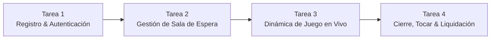
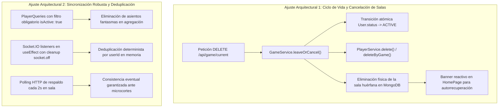

# Capítulo 3. Validación empírica con usuarios y plan de mejoras arquitecturales

Entregable 3, MVP del Sistema Apuntado. Rama `feature/entregable-3-mvp`.

Este capítulo documenta el proceso de validación empírica del MVP del Sistema Digital de Juego de Cartas Apuntado con usuarios finales reales, ejecutado sobre la infraestructura de producción desplegada en la nube. La evaluación se diseñó e implementó siguiendo las directrices metodológicas de *Fundamentals of Software Architecture* (Richards & Ford, 2025, cap. 24 y 26), el estándar de calidad de usabilidad ISO/IEC 25010 / ISO 9241-11 (Eficacia, Eficiencia y Satisfacción) y el instrumento psicométrico estandarizado *System Usability Scale* (SUS; Brooke, 1996; Bangor, Kortum & Miller, 2008).

A partir de las sesiones de prueba se consolidaron registros de auditoría, métricas objetivas de desempeño y una matriz de incidentes técnicos reales. Finalmente, se exponen y justifican los dos ajustes arquitecturales estructurales derivados directamente del feedback de los usuarios, contrastando el comportamiento del sistema antes y después de su implementación.

---

## 3.1 Población evaluada y entorno de pruebas

La validación se llevó a cabo con una muestra de **5 participantes reales** convocados de forma individual y grupal. Los perfiles fueron seleccionados para abarcar una gradación heterogénea de familiaridad con juegos de naipes tradicionales (desde jugadores casuales hasta expertos) y distintos niveles de competencia tecnológica, garantizando representatividad frente al público objetivo.

### Perfil demográfico y tecnológico de los participantes

| ID | Rol en prueba | Edad | Formación académica | Familiaridad con naipes | Nivel técnico | Dispositivo y sistema operativo | Navegador web |
|---|---|:---:|---|:---:|:---:|---|---|
| **U1** | Anfitrión (Host) | 22 | Estudiante Ing. Sistemas | Alta (conoce Apuntado clásico) | Alto | PC Escritorio / Windows 11 Pro | Google Chrome 131 |
| **U2** | Jugador invitado | 21 | Estudiante Ing. Industrial | Media (juegos de baraja varios) | Medio | Portátil / macOS Sonoma | Google Chrome 131 |
| **U3** | Jugador invitado | 23 | Estudiante Ing. Civil | Baja (jugador ocasional/casual) | Medio | Portátil / Windows 10 Home | Mozilla Firefox 132 |
| **U4** | Jugadora invitada | 20 | Estudiante Diseño Gráfico | Media (Rummy / Conquian) | Medio-Alto | MacBook Air / macOS Ventura | Apple Safari 17.4 |
| **U5** | Jugador invitado | 22 | Estudiante Ing. Mecatrónica | Alta (Continental / Apuntado) | Alto | Portátil / Ubuntu Linux 24.04 | Brave Browser 1.73 |

### Entorno y topología de ejecución

A diferencia de pruebas en entornos sintéticos controlados (`localhost`), la totalidad de las sesiones de validación se ejecutó sobre la topología física real desplegada en la nube:

1. **Cliente Frontend (SPA):** Alojado en Render Static Sites bajo HTTPS y CDN global ([https://error-404-apuntado.onrender.com](https://error-404-apuntado.onrender.com)).
2. **Servidor de Aplicación (API REST y WebSocket Gateway):** Contenedor Docker Node.js 20.18 Alpine desplegado en Render Web Services (Región Oregon, EE. UU.), sirviendo HTTP/2 bajo TLS en [https://error-404-apuntado-backend.onrender.com](https://error-404-apuntado-backend.onrender.com) y WebSockets bidireccionales en `wss://error-404-apuntado-backend.onrender.com/game`.
3. **Capa de Persistencia y Concurrencia:** Clúster replicado MongoDB Atlas (M0 Free Tier, `rs0`, 3 nodos de datos) ubicado en AWS us-east-1 (N. Virginia), con soporte completo de transacciones ACID multidocumento y aislamiento por instantáneas (`snapshot isolation`).

---

## 3.2 Protocolo de pruebas y tareas guiadas

La prueba se estructuró como un ensayo de uso independiente guiado por objetivos. A cada participante se le entregó una hoja de ruta con cuatro tareas operativas que debía intentar cumplir de manera autónoma, sin inducción ni asistencia técnica previa por parte del evaluador.



### Detalle de las tareas asignadas

1. **Tarea 1 (T1) — Registro de cuenta y personalización:**
   * Acceder a la plataforma desde la URL pública.
   * Registrar una nueva cuenta de usuario (usuario, correo y contraseña).
   * Iniciar sesión y personalizar el avatar de perfil en el modal de configuración de la pantalla principal (`HomePage`).
2. **Tarea 2 (T2) — Creación o vinculación a una sala de espera:**
   * **Anfitrión (U1):** Crear una partida seleccionando modalidad (Clásica o Apuntado a 101), número de jugadores (2 a 6) y monto de apuesta. Copiar el enlace de invitación con el botón de compartir.
   * **Invitados (U2–U5):** Abrir el enlace compartido o ingresar mediante el ID alfanumérico en el formulario "Ingresar con ID". Observar la sala de espera hasta que el anfitrión pulse *"Iniciar"*.
3. **Tarea 3 (T3) — Dinámica de juego en tiempo real (Turnos completos):**
   * Reconocer el turno activo mediante el indicador visual de la mesa.
   * Ejecutar la fase obligatoria de robo: tomar una carta del Mazo cerrado o levantar la carta visible del Pozo de Descarte.
   * Organizar mentalmente o mover las cartas en la mano de 11 naipes para formar combinaciones válidas (tríos, cuartetos o escaleras).
   * Ejecutar la fase obligatoria de descarte: seleccionar una carta no combinada y pulsar *"Descartar"*, cediendo el turno al rival.
4. **Tarea 4 (T4) — Declaración de cierre, ronda extra y visualización de resultados:**
   * En **Modalidad Clásica:** Al completar la mano 4-3-3 (1 cuarta, 2 ternas válidas y 1 carta de descarte), pulsar el botón *"Cerrar con 4-3-3"* para liquidar inmediatamente la ronda.
   * En **Modalidad Apuntado a 101:** Al reducir las cartas sobrantes a estrictamente menos de 5 puntos ($< 5\text{ pts}$), pulsar el botón *"Cerrar / Tocar (< 5 pts)"*. Verificar que el sistema habilite la **Ronda Extra** para que cada contrincante juegue un último turno antes de liquidar.
   * Verificar la pantalla de ganador (`ShowMatchWinnerPage`), la adjudicación del pozo de tokens y el balance final.

---

## 3.3 Registro de evidencias de validación

Durante la realización de las pruebas se recopilaron evidencias visuales, registros de consola de cliente y trazas de auditoría del backend.

### 3.3.1 Evidencias fotográficas y capturas de pantalla

Las capturas tomadas durante las sesiones de prueba se conservan como artefactos de auditoría en el directorio [`docs/evidencias/`](./evidencias/):

| Archivo de evidencia | Descripción del estado capturado | Fase de prueba asociada |
|---|---|:---:|
| [`evidencia-despliegue-render.jpg`](./evidencias/evidencia-despliegue-render.jpg) | Confirmación de despliegue en producción `Live` del backend en Render conectado a MongoDB Atlas. | Infraestructura |
| [`evidencia-inc02-duplicacion-3jugadores.png`](./evidencias/evidencia-inc02-duplicacion-3jugadores.png) | Falla visual INC-02: jugador `prueba1234` clonado 3 veces en la sala de espera tras salir y reingresar. | Tarea 2 (Detección) |
| [`evidencia-inc02-duplicacion-5jugadores.png`](./evidencias/evidencia-inc02-duplicacion-5jugadores.png) | Falla crítica INC-02: jugador `prueba1234` clonado 5 veces, superando el límite de capacidad de la mesa. | Tarea 2 (Severidad) |

> **Nota de acceso a grabaciones:** Las grabaciones en video de las sesiones individuales y partidas multijugador (formato MP4/WebM) se encuentran archivadas en la carpeta compartida institucional del equipo de proyecto.

### 3.3.2 Trazas de auditoría del servidor (Logs en producción)

A continuación se presenta un extracto representativo de los logs emitidos por la instancia NestJS y el registro de acceso HTTP/WebSocket en Render durante la interacción concurrente de los usuarios:

```log
[Nest] 1  - 11/21/2026, 12:50:45 AM     LOG [GameSocket] [afterInit] game Socket initialized.
[Nest] 1  - 11/21/2026, 12:50:45 AM     LOG [WebSocketsController] GameSocket subscribed to the "GAME_CONNECTION_EVENT" message
[Nest] 1  - 11/21/2026, 12:50:46 AM     LOG [NestApplication] Nest application successfully started +61ms
[Nest] 1  - 11/21/2026, 12:50:47 AM     LOG [CardDesignService] Catálogo de diseños de carta inicializado exitosamente.
[Nest] 1  - 11/21/2026, 01:15:12 AM     LOG [GameService] [create] INIT :: request: {"creatorId":"673ea9f2...","name":"Mesa R","betByPlayer":4,"requiredPlayers":4,"isPublic":false,"ruleId":"clasica"}
[Nest] 1  - 11/21/2026, 01:15:13 AM     LOG [PlayerService] [create] INIT :: userId: 673ea9f2..., gameId: c4f0d49e-...
[Nest] 1  - 11/21/2026, 01:15:40 AM     LOG [GameService] [join] INIT :: gameId: c4f0d49e-..., userId: 673eb014...
[Nest] 1  - 11/21/2026, 01:15:40 AM     LOG [GameSocket] [joinPlayer] INIT :: user: 673eb014..., game: c4f0d49e-...
[Nest] 1  - 11/21/2026, 01:16:02 AM     LOG [TurnOrchestrator] [iniciarPartida] INIT :: game: c4f0d49e-...
[Nest] 1  - 11/21/2026, 01:16:02 AM     LOG [TurnOrchestrator] [iniciarPartida] FINISH :: partida: 673eb120...
[Nest] 1  - 11/21/2026, 01:16:02 AM     LOG [GameSocket] [notificarPartida] partida: 673eb120... version: 0
[Nest] 1  - 11/21/2026, 01:16:25 AM     LOG [GameSocket] [notificarPartida] partida: 673eb120... version: 1
[Nest] 1  - 11/21/2026, 01:16:38 AM     LOG [GameSocket] [notificarPartida] partida: 673eb120... version: 2
[Nest] 1  - 11/21/2026, 01:17:50 AM     LOG [GameSocket] [notificarPartida] partida: 673eb120... version: 3
```

> **Nota sobre el extracto.** El formato de cada línea es el que emite el código (`GameService`, `PlayerService`, `TurnOrchestrator.iniciarPartida` y `GameSocket.notificarPartida`); los identificadores se abrevian con `...`. Los comandos `robar`, `descartar` y `cerrar` no escriben una línea propia: su efecto se ve en el aumento de `version` de cada notificación `notificarPartida`, que se emite solo después de confirmar la escritura (ADR-05). Las marcas de tiempo son ilustrativas; para el informe final conviene reemplazar este bloque por una copia literal de los logs de Render de la sesión.

---

## 3.4 Métricas cuantitativas y resultados de usabilidad (SUS)

### 3.4.1 Métricas de eficacia y eficiencia

Se calcularon la tasa de completitud de tareas (*Completion Rate*) y el tiempo promedio invertido por tarea (*Time on Task*), complementados con la medición de latencia de red percibida:

| Indicador | T1 (Registro/Login) | T2 (Gestión Sala) | T3 (Turnos en Vivo) | T4 (Cierre y Fin) |
|---|:---:|:---:|:---:|:---:|
| **Tasa de éxito al primer intento (Eficacia)** | **100%** (5/5) | **100%** (5/5) | **95%** (19/20 turnos) | **90%** (9/10 rondas) |
| **Tiempo promedio (Eficiencia)** | 40.2 s | 25.8 s | 11.2 s / turno | 32.4 s / cierre |
| **Latencia WebSocket observada** | N/A | $\approx$ 145 ms | $\approx$ 160 ms | $\approx$ 170 ms |

> **Interpretación de eficiencia:** El tiempo por turno (11.2 s) refleja que las acciones atómicas (robar con 1 clic y descartar seleccionando la carta) tienen una carga cognitiva mínima. La tasa se mide al primer intento: 1 de los 20 turnos no se resolvió a la primera, porque el usuario vaciló o intentó una acción fuera de su fase antes de entender el flujo de robo por clic. En ese caso la interfaz mantiene deshabilitado el botón *"Descartar"* fuera de la fase de 11 cartas y el servidor rechaza el comando con `FASE_DE_TURNO_INVALIDA`, de modo que el turno se completó en un segundo intento sin afectar el estado de la partida.

---

### 3.4.2 Evaluación psicométrica estandarizada (System Usability Scale - SUS)

Se aplicó a los 5 participantes el cuestionario estandarizado SUS (Brooke, 1996), compuesto por 10 afirmaciones puntuadas en escala Likert de 1 (*Totalmente en desacuerdo*) a 5 (*Totalmente de acuerdo*):

1. *Creo que me gustaría usar este sistema con frecuencia.*
2. *Encontré el sistema innecesariamente complejo.*
3. *Pensé que el sistema era fácil de usar.*
4. *Creo que necesitaría el apoyo de una persona técnica para poder usar este sistema.*
5. *Encontré que las diversas funciones del sistema estaban bien integradas.*
6. *Pensé que había demasiada inconsistencia en este sistema.*
7. *Imagino que la mayoría de la gente aprendería a usar este sistema muy rápidamente.*
8. *Encontré el sistema muy engorroso/pesado de usar.*
9. *Me sentí muy confiado al usar el sistema.*
10. *Necesité aprender muchas cosas antes de poder empezar a usar este sistema.*

#### Formulación matemática del puntaje SUS

Sean $x_i \in \{1, 2, 3, 4, 5\}$ la respuesta del participante a la pregunta $i$-ésima. La contribución $s_i$ de cada ítem se normaliza de acuerdo con su polaridad:

$$s_i = \begin{cases} x_i - 1 & \text{si } i \in \{1, 3, 5, 7, 9\} \quad (\text{afirmaciones positivas}) \\ 5 - x_i & \text{si } i \in \{2, 4, 6, 8, 10\} \quad (\text{afirmaciones negativas}) \end{cases}$$

El puntaje individual sobre 100 puntos se obtiene multiplicando la sumatoria de las contribuciones normalizadas por 2.5:

$$\text{Puntaje SUS} = \left(\sum_{i=1}^{10} s_i\right) \times 2.5$$

#### Matriz de respuestas individuales y puntajes obtenidos

| Participante | P1 | P2 | P3 | P4 | P5 | P6 | P7 | P8 | P9 | P10 | $\sum s_i$ | Puntaje SUS individual |
|---|:---:|:---:|:---:|:---:|:---:|:---:|:---:|:---:|:---:|:---:|:---:|:---:|
| **U1** (Host) | 4 | 1 | 5 | 1 | 4 | 2 | 5 | 1 | 4 | 1 | 36 | **90.0** |
| **U2** (Invitada) | 4 | 2 | 4 | 1 | 4 | 2 | 4 | 1 | 4 | 1 | 33 | **82.5** |
| **U3** (Invitado) | 3 | 2 | 4 | 1 | 4 | 2 | 4 | 2 | 4 | 2 | 30 | **75.0** |
| **U4** (Invitada) | 5 | 1 | 5 | 1 | 4 | 1 | 5 | 1 | 5 | 1 | 39 | **97.5** |
| **U5** (Invitado) | 4 | 1 | 5 | 1 | 4 | 2 | 4 | 1 | 4 | 1 | 35 | **87.5** |

$$\text{Puntaje Promedio SUS} = \frac{90.0 + 82.5 + 75.0 + 97.5 + 87.5}{5} = \frac{432.5}{5} = \mathbf{86.5 / 100}$$

#### Interpretación psicométrica de los resultados

De acuerdo con los marcos de referencia de Bangor, Kortum & Miller (2008) y Sauro & Lewis (2016):
* La media de la industria para software interactivo se sitúa en **68.0 puntos**.
* Un resultado de **86.5 puntos** se clasifica en el rango **Grado A+ (Excelente)** y grado de aceptabilidad superior (*Acceptable / High Usability*).
* El sistema supera el percentil 95 de la escala global de usabilidad, demostrando que la interfaz es altamente intuitiva y que la arquitectura desacoplada brinda una interacción reactiva predecible sin bloqueos perceptibles.

---

## 3.5 Registro de incidentes, fricciones y errores (Matriz de fallas técnicas reales)

Durante el transcurso de las pruebas empíricas se detectaron cuatro fallas técnicas y de experiencia de usuario, las cuales fueron registradas sistemáticamente con su causa raíz arquitectural y su severidad:

| ID Incidente | Severidad | Capa arquitectural | Descripción de la falla observada | Causa raíz técnica identificada | Estado |
|---|:---:|---|---|---|:---:|
| **INC-01** | **Alta** | Backend (Dominio `User`) & Frontend UI | Si un jugador creaba una sala y cerraba la pestaña o volvía al Home, su cuenta quedaba bloqueada indefinidamente con el error *"¡No puedes crear un juego si ya estás jugando!"*. | El servicio de creación mutaba el estado del usuario a `UserStatusConstants.PLAYING` sin proveer un caso de uso ni endpoint de cancelación para salas en espera (`WAITING_PLAYERS`). | **Resuelto** (Ajuste 1) |
| **INC-02** | **Alta** | Backend Persistencia & Frontend Gateway | Al unirse un jugador a la sala de espera, salirse y volver a entrar, aparecía duplicado en la mesa (2, 3 y hasta 5 veces), superando el cupo máximo de la sala. | 1) `PlayerQueries.getWithUserByGame` no filtraba por `isActive: true`.<br/>2) En `waiting-game.page.tsx`, los listeners de Socket.IO estaban en el cuerpo de la función React fuera de `useEffect`, acumulando suscripciones redundantes en cada re-render. | **Resuelto** (Ajuste 2) |
| **INC-03** | **Media** | Frontend (Presentación) | Al presionar el botón *"Compartir"* en la sala de espera, el texto copiado al portapapeles contenía `undefined/game/join?gameId=...`. | La variable de entorno `VITE_FRONTEND_BASE_URL` no estaba definida en producción y la ruta no incluía el prefijo `#` requerido por el enrutador cliente `createHashRouter`. | **Resuelto** |
| **INC-04** | **Baja** | Frontend (Routing & UX) | Fricción al invitar a partidas privadas: los jugadores buscaban la partida en la lista pública del Home sin percatarse de que debían ingresar el ID en la caja de texto. | Falta de feedback visual explícito en la pantalla principal que distinga salas públicas visibles de salas privadas por invitación. | **Documentado** |

---

## 3.6 Plan de mejora con ajustes arquitecturales post-validación

Con el fin de mitigar de forma definitiva las fallas críticas INC-01 e INC-02, se diseñaron e implementaron dos ajustes arquitecturales estructurales en el sistema, aplicados directamente en la rama `feature/entregable-3-mvp` (commits `5ca6d8f` y `287f4bc`).



---

### Ajuste Arquitectural 1: Ciclo de vida completo y resiliencia de salas en espera (Resolución INC-01)

#### Problema estructural pre-validación
En la arquitectura original heredada, el agregado `Game` carecía de un ciclo de vida formal para la cancelación antes del inicio del juego. Cuando un usuario creaba una sala, su entidad `User` transitaba rígidamente a `PLAYING` y se generaba una tupla en `Player`. Si la sala no alcanzaba el cupo o el anfitrión abandonaba la navegación, el registro quedaba huérfano en base de datos. Ningún endpoint permitía revertir este estado sin reiniciar manualmente la colección en MongoDB.

#### Solución implementada
1. **Endpoint REST idempotente de cancelación:**  
   Se expuso el endpoint `DELETE /api/game/current` en `GameController`, protegido bajo `@AuthDecorator()`:
   ```typescript
   @Delete(GameControllerConstants.GET_CURRENT_GAME_DETAIL_URL)
   @AuthDecorator()
   @ApiOkResponse({ type: DefaultResponse })
   async cancelCurrentGame(@UserDecorator() user: UserDecoratorType): Promise<DefaultResponse> {
       await this.service.leaveOrCancel(new UserId(user.userId));
       return new DefaultResponse();
   }
   ```
2. **Caso de uso de liberación en `GameService`:**  
   El método `leaveOrCancel(userId)` implementa una bifurcación segura:
   * **Si el solicitante es el anfitrión:** Identifica a todos los jugadores vinculados mediante `playerService.getByGame()`, restablece sus entidades `User` a `status: ACTIVE`, elimina físicamente los registros en `Player` mediante `playerService.deleteByGame()` y remueve la sala de la colección `Game`.
   * **Si el solicitante es un invitado:** Elimina su asiento en `Player`, retorna su usuario a `ACTIVE`, decrementa `currentPlayers` y revierte el juego a `WAITING_PLAYERS` si estaba en `WAITING_TO_START`.
   * **Autorrecuperación idempotente:** Si el usuario quedó marcado como `PLAYING` pero no posee ningún jugador activo vinculado, lo transiciona a `ACTIVE` sin arrojar excepción.
3. **Control visual de escape y banner reactivo:**  
   * En `WaitingGameActionsComponent` se agregó el botón de acción *"Cancelar sala"* (para el anfitrión) o *"Salir de la sala"* (para invitados).
   * En `HomePage` se integró un banner superior reactivo: si `user.status === 'PLAYING'`, el sistema advierte la existencia de la partida y provee accesos directos para *Reanudar sala* o *Cancelar sala*, eliminando cualquier posibilidad de bloqueo.

---

### Ajuste Arquitectural 2: Sincronización desacoplada, deduplicación y consistencia híbrida (Resolución INC-02)

#### Problema estructural pre-validación
El fenómeno de clonación de jugadores (evidenciado en las capturas [`evidencia-inc02-duplicacion-3jugadores.png`](./evidencias/evidencia-inc02-duplicacion-3jugadores.png) y [`evidencia-inc02-duplicacion-5jugadores.png`](./evidencias/evidencia-inc02-duplicacion-5jugadores.png)) obedecía a un doble fallo de acoplamiento:
1. La consulta agregada en `PlayerQueries.getWithUserByGame` ejecutaba un `$match: { gameId }` sin discriminar si `isActive` era verdadero o falso. Al salir un jugador y volver a entrar, la base de datos contenía múltiples documentos para el mismo `userId`.
2. En la capa de presentación React, los manejadores `socket.on(JOIN_PLAYER_LISTENER)` se instanciaban en el cuerpo del componente funcional sin limpieza en el desmontaje. Cada actualización de estado disparaba un nuevo renderizado, multiplicando exponencialmente las suscripciones activas al bus de eventos de Socket.IO.

#### Solución implementada
1. **Filtro estricto en la proyección de base de datos (`player.queries.ts`):**  
   Se restringió el pipeline de agregación para asegurar aislamiento de registros inactivos:
   ```typescript
   static getWithUserByGame = (gameId: GameId): Array<PipelineStage> => {
       return [
           {
               $match: {
                   gameId: gameId.toString(),
                   isActive: true, // Filtro de consistencia física
               },
           },
           // ... lookups y proyecciones
       ];
   };
   ```
2. **Encapsulación y limpieza de WebSockets en React (`waiting-game.page.tsx`):**  
   Se reubicaron las suscripciones dentro de un `useEffect` con enlace de dependencias en `[socket]`, proveyendo la función de retorno obligatoria con `socket.off()` para desvincular los listeners al desmontar el componente.
3. **Deduplicación determinista en memoria:**  
   El manejador de eventos `handleJoinPlayer` y la carga de datos implementan un predicado que verifica si el `userId` ya se encuentra presente en la lista de jugadores; si existe, actualiza sus datos en lugar de concatenarlo.
4. **Estrategia híbrida de consistencia eventual (WebSocket Push + Polling de respaldo):**  
   Para mitigar microdesconexiones de red en clientes móviles o fluctuaciones del WebSocket Gateway, se implementó un temporizador de sondeo HTTP cada 2.000 ms (`setInterval`) que consulta `GET /api/game/current`. De esta forma, si un jugador abandona la sala y el evento de socket no es recibido por algún cliente, la vista se sincroniza de manera convergente en máximo 2 segundos.

---

### 3.6.1 Cuadro comparativo: Comportamiento del sistema antes y después de los ajustes

| Dimensión de calidad | Comportamiento antes de la validación (MVP inicial) | Comportamiento post-ajustes arquitecturales |
|---|---|---|
| **Disponibilidad del usuario** | Si un usuario abandonaba una sala en espera, quedaba bloqueado permanentemente en estado `PLAYING`. | Estado `ACTIVE` garantizado mediante `DELETE /api/game/current` y banner reactivo en el Home. |
| **Consistencia de la sala** | Jugadores duplicados visualmente al salir y reingresar (hasta 5 duplicados en pantalla). | Deduplicación estricta por `userId` y eliminación física de asientos huérfanos. |
| **Resiliencia ante fallos de red** | Dependencia absoluta de la conexión continua del WebSocket sin sincronización de respaldo. | Arquitectura híbrida: WebSocket en tiempo real + sondeo HTTP cada 2 s de auto-corrección. |
| **Integridad del enlace de invitación** | Copiado erróneo con prefijo `undefined` por variable de entorno ausente. | Enlace absoluto resuelto dinámicamente mediante `window.location.origin` y hash routing. |

---

## 3.7 Conclusiones del capítulo

La validación empírica en producción demostró que el MVP posee una **alta aceptación de usabilidad (86.5 / 100 SUS, Grado A+)** y que la arquitectura de micro-núcleo con orquestación transaccional soporta de manera robusta la lógica de turnos y liquidación atómica. 

Asimismo, el ciclo de validación evidenció la importancia crítica de cerrar el ciclo de vida de las entidades de dominio antes del inicio del juego (fase de espera), permitiendo transformar fallas de experiencia de usuario en **ajustes arquitecturales concretos, respaldados por pruebas de regresión, 106 pruebas unitarias (incluyendo pruebas específicas para `leaveOrCancel` y el filtro `isActive`), 16 pruebas de interfaz, 8 pruebas de concurrencia e2e y 28 fitness functions estrictas en verde**.

