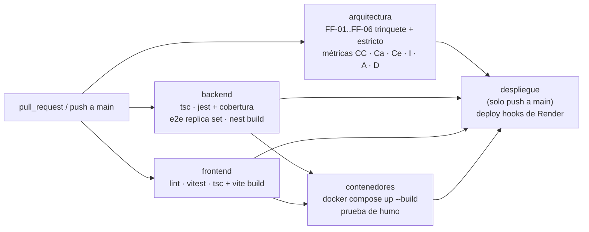

# Capítulo 4. Pipeline CI/CD y métricas cuantitativas de arquitectura

Entregable 3, MVP del Sistema Apuntado. Rama `feature/entregable-3-mvp`.

Este capítulo describe cómo se gobierna automáticamente la arquitectura del MVP. Tiene tres
partes:

1. **El pipeline CI/CD** de GitHub Actions (`.github/workflows/ci.yml`). Decide si un cambio
   puede integrarse y desplegarse.
2. **Las métricas estructurales** de Richards & Ford (2025, cap. 3): complejidad ciclomática,
   acoplamiento aferente y eferente, inestabilidad, abstracción y distancia a la secuencia
   principal. Se calculan con un script versionado y el pipeline las publica en cada ejecución.
3. **Las 28 fitness functions** de `tests/architecture/` (FF-01 a FF-06), en modo trinquete y en
   modo estricto (Richards & Ford, 2025, cap. 6).

Todos los números de este capítulo se obtuvieron de esta rama el 2026-11-22 y se pueden volver a
generar con los comandos de la sección 4.5.

---

## 4.1 Pipeline CI/CD en GitHub Actions

### 4.1.1 Estructura

El pipeline es un solo *workflow* con cinco *jobs*. Los cuatro primeros son puertas de calidad:
si cualquiera falla, el cambio no se integra y no se despliega.



| Job | Qué ejecuta | Qué garantiza | Artefacto |
|---|---|---|---|
| `arquitectura` | `npm ci`, `npm test` (trinquete), `npm run test:estricto`, `npm run metricas` en `tests/architecture` | La estructura no se degrada: capas, microkernel, ciclos, complejidad, motor sin framework y esquemas de datos (sección 4.3). | `metricas-arquitectura` (JSON y Markdown); la tabla también aparece en el resumen del job. |
| `backend` | `npm ci`, `tsc --noEmit`, `jest --ci --coverage` (106 pruebas), `npm run test:e2e` (8 pruebas con un replica set de MongoDB en memoria), `npm run build` | El código compila. Las reglas, los plug-ins, el agregado y el orquestador se comportan como se espera. La concurrencia del cierre (R03) sigue protegida. | `cobertura-backend` (informe LCOV) |
| `frontend` | `yarn install --frozen-lockfile`, `yarn lint`, `yarn test` (16 pruebas Vitest), `yarn build` (`tsc && vite build`) | La SPA compila con el mismo lockfile que la imagen Docker y la lógica del tablero (traducción de comandos, versiones) sigue correcta. | — |
| `contenedores` | `docker compose config`, `docker compose up -d --build` y una prueba de humo con `curl` sobre `:3000/docs`, `:5173/` y `:5173/docs` (a través del proxy de Nginx); además comprueba que `mongo-init` terminó con código 0 | Las dos imágenes se construyen y el sistema completo arranca en el orden de salud definido: replica set PRIMARY → validadores → backend sano → frontend. | Registros de los contenedores si falla |
| `despliegue` | `POST` a los *deploy hooks* de Render (backend y frontend) | Solo se despliega lo que pasó las cuatro puertas. Se ejecuta únicamente en `push` a `main`. | — |

### 4.1.2 Disparadores, concurrencia y permisos

- **Disparadores.** `pull_request` (todas las ramas), `push` a `main`/`master` y ejecución manual
  (`workflow_dispatch`). Un PR desde `feature/entregable-3-mvp` hacia `main` ejecuta las cuatro
  puertas; el merge a `main` las repite y, si pasan, despliega.
- **Concurrencia.** `concurrency: ci-${{ github.ref }}` con `cancel-in-progress`: un *push* nuevo
  a la misma rama cancela la ejecución anterior.
- **Mínimo privilegio.** `permissions: contents: read`. El pipeline no publica paquetes ni
  escribe en el repositorio.
- **Secretos.** Los JWT del job `contenedores` se generan por ejecución y solo existen en el
  *runner* efímero. Los *deploy hooks* se leen de los secretos `RENDER_DEPLOY_HOOK_BACKEND` y
  `RENDER_DEPLOY_HOOK_FRONTEND`. Si no están configurados, el job emite un aviso y termina sin
  desplegar, en lugar de fallar.
- **Cachés.** npm (`tests/architecture`, `backend`), yarn (`frontend`) y los binarios de MongoDB
  que descarga `mongodb-memory-server`.

### 4.1.3 Qué cambió respecto al pipeline anterior

Antes existía solo `.github/workflows/architecture-fitness.yml`, que ejecutaba las fitness
functions. Ahora `ci.yml` incluye ese mismo job, con el mismo identificador `arquitectura` para
que se conserven las reglas de protección de rama que lo exijan, y suma las pruebas, las
compilaciones, la prueba de humo con contenedores y el despliegue condicionado. El archivo
anterior se eliminó para no ejecutar dos veces las mismas pruebas en cada PR.

| Puerta | Antes | Ahora |
|---|---|---|
| Fitness functions (trinquete y estricto) | ✅ | ✅ |
| Métricas de arquitectura publicadas | — | ✅ |
| Tipos, pruebas unitarias y e2e del backend | — | ✅ |
| Lint, pruebas y build del frontend | — | ✅ |
| Imágenes Docker y arranque con docker compose | — | ✅ |
| Despliegue solo tras todas las puertas | — | ✅ (requiere los secretos de Render) |

### 4.1.4 Verificación exitosa en GitHub Actions (PR #1)

El workflow se ejecutó de forma automatizada sobre GitHub Actions en la apertura del Pull Request #1 hacia `main`, completando exitosamente la totalidad de las puertas de calidad:


| Job ejecutado | Estado | Duración | Verificaciones cumplidas |
|---|:---:|:---:|---|
| `arquitectura` | ✅ | 48s | 28 fitness functions (modo trinquete y estricto) + cálculo y publicación de métricas de calidad. |
| `backend` | ✅ | 57s | Compilación TypeScript, 106 pruebas unitarias Jest con cobertura, 8 pruebas de concurrencia e2e y build NestJS. |
| `contenedores` | ✅ | 1m 00s | Construcción multi-stage de imágenes y prueba de integración multi-contenedor con `docker compose`. |
| `frontend` | ✅ | 1m 00s | Linting, 16 pruebas unitarias Vitest y build de producción Vite de la SPA. |
| `despliegue` | ⚪ | Omitido | Condicionado por diseño para ejecutarse exclusivamente tras el merge a la rama `main`. |

Para que el pipeline gobierne de verdad la rama `main`, se puede configurar en GitHub la protección
de rama con los checks obligatorios `arquitectura`, `backend`, `frontend` y `contenedores`. Si el
despliegue pasa a hacerse desde el pipeline, también se puede desactivar el *auto-deploy* de Render,
para que ningún cambio llegue a producción sin pasar por las puertas.

---

## 4.2 Métricas estructurales cuantitativas

### 4.2.1 Definiciones

Las métricas siguen a Richards & Ford (2025, cap. 3), que retoman las de Martin (1994):

| Métrica | Fórmula | Lectura |
|---|---|---|
| Complejidad ciclomática (CC) | CC = E − N + 2, equivalente a 1 + número de puntos de decisión | Cantidad de caminos independientes de una función; a más caminos, más difícil probarla y cambiarla. |
| Acoplamiento aferente (Ca) | Componentes que dependen de este | Responsabilidad: cuántos se rompen si este cambia. |
| Acoplamiento eferente (Ce) | Componentes de los que este depende | Dependencia: cuántos cambios ajenos lo pueden afectar. |
| Inestabilidad (I) | I = Ce / (Ca + Ce) | 0 = estable (muchos dependen de él); 1 = inestable (fácil de cambiar). |
| Abstracción (A) | A = Na / (Na + Nc) | Proporción de elementos abstractos frente a concretos. |
| Distancia a la secuencia principal (D) | D = \|A + I − 1\| | 0 = equilibrio ideal entre estabilidad y abstracción. |

La **secuencia principal** es la recta A + I = 1. Cerca del origen (A ≈ 0, I ≈ 0) está la **zona
de dolor**: componentes concretos de los que dependen muchos, caros de cambiar. Cerca de
(1, 1) está la **zona de inutilidad**: abstracciones que nadie usa.

### 4.2.2 Definiciones operativas en este proyecto

Estas métricas nacieron para lenguajes orientados a clases. Para aplicarlas a TypeScript hubo que
tomar las siguientes decisiones, implementadas en `tests/architecture/metricas.ts`:

- **Componente.** Cada carpeta `src/<módulo>`. En las capas `aplicacion/`, `dominio/` y
  `reglas/`, el componente es la subcarpeta (`src/dominio/partida`, `src/reglas/contrato`, ...).
  Cada plug-in (`plugins/clasica`, `plugins/apuntado`) es un componente. Los archivos sueltos de
  `src/` (`main.ts`, `app.module.ts` y la raíz de composición `reglas-plugins.module.ts`) forman
  `src/(raiz)`. En total hay 29 componentes.
- **Ca y Ce.** Se cuentan componentes distintos, no archivos, a partir de los `import` entre
  archivos del backend (criterio de JDepend). Los paquetes npm no cuentan en Ce; se informan
  aparte en el JSON.
- **Na y Nc.** Na cuenta las `interface` y las `abstract class`. Nc cuenta las clases concretas y
  las funciones de nivel de módulo (declaradas o asignadas a una constante). Los alias `type` y
  los `enum` no cuentan ni como abstractos ni como concretos.
- **CC.** La calcula la regla `complexity` de ESLint, la misma de FF-04, para cada función,
  método y *arrow function*. Se excluyen las pruebas (`*.spec.ts`).

**Advertencia de interpretación.** En TypeScript muchas `interface` describen datos (por ejemplo,
el agregado `Partida`), no contratos con varias implementaciones. Por eso A sobrestima la
abstracción de los componentes de datos, como `src/dominio/partida` o `src/database`, y la refleja
bien en los de contratos, como `src/reglas/contrato`.

### 4.2.3 Complejidad ciclomática

| Alcance | Funciones | Media | Mediana | P90 | Máxima | Umbral | Sobre el umbral |
|---|---:|---:|---:|---:|---:|---:|---:|
| Núcleo y plug-ins (alcance de FF-04) | 218 | 1.67 | 1 | 3 | 7 | 10 | **0** |
| Backend completo | 471 | 1.57 | 1 | 3 | 8 | 15 | **0** |

| Función más compleja | Ubicación | CC |
|---|---|---:|
| `resolveMessage` (traducción unificada de excepciones) | `shared/exceptions/app.exception-filter.ts:25` | 8 |
| `resolverConflicto` (respuesta controlada tras perder la carrera) | `aplicacion/partida/turn-orchestrator.service.ts:229` | 7 |
| `changeStatus` (máquina de estados de jugador) | `dominio/player/player.ts:253` | 7 |
| `validarGrupos` (organización de la mano) | `dominio/partida/comandos-partida.ts:164` | 6 |
| `leaveOrCancel` (cancelación/abandono modularizada tras refactor) | `aplicacion/game/game.service.ts:222` | 6 |
| `ejecutar`, `intentarCierre`, `concluirRonda` | orquestador y agregado | 5 |

**Lectura.**

- En el núcleo y los plug-ins, la función más compleja tiene CC 7, con holgura respecto del umbral
  de 10. La mediana es 1 porque el dominio está partido en funciones pequeñas y puras; esa
  partición fue la que permitió reemplazar las tablas de 260 ternas y 299 cuartas del prototipo
  por un evaluador algorítmico.
- En el backend completo, la función más compleja tiene CC 8 (`resolveMessage`). Inicialmente,
  la función `leaveOrCancel` introducida en la fase 5 registraba un CC de 13; dicha deuda técnica
  fue abordada inmediatamente mediante su descomposición en métodos privados especializados
  (`cancelGameAsHost`, `leaveGameAsGuest`, `releaseUserToActive`), reduciendo su complejidad a **CC 6**
  e incorporando su correspondiente suite de pruebas unitarias (`game.service.leave-cancel.spec.ts`).
  Como resultado, **ninguna función supera el umbral de 10 en el núcleo ni de 15 en todo el backend**.

### 4.2.4 Acoplamiento, inestabilidad, abstracción y distancia

Resumen: **29 componentes · D media 0.36 · 20 cerca de la secuencia principal (D ≤ 0.5) · 9 en la
zona de dolor · 0 en la zona de inutilidad.**

**Componentes del microkernel**

| Componente | Ca | Ce | I | A | D | Usado por | Depende de |
|---|---:|---:|---:|---:|---:|---|---|
| `src/reglas/contrato` | 6 | 0 | 0.00 | 0.91 | **0.09** | 2 plug-ins, `dominio/partida`, `aplicacion/partida`, `reglas/evaluador`, `reglas/registro` | — |
| `plugins/clasica` | 1 | 2 | 0.67 | 0.00 | 0.33 | solo `src/(raiz)` (raíz de composición) | contrato, evaluador |
| `plugins/apuntado` | 1 | 2 | 0.67 | 0.50 | 0.17 | solo `src/(raiz)` | contrato, evaluador |
| `src/reglas/registro` | 3 | 1 | 0.25 | 0.17 | 0.58 | `src/(raiz)`, `aplicacion/partida`, `aplicacion/game` | contrato |
| `src/reglas/evaluador` | 2 | 1 | 0.33 | 0.09 | 0.58 | los 2 plug-ins | contrato |
| `src/dominio/partida` | 6 | 2 | 0.25 | 0.37 | 0.38 | orquestador, controladores, gateway, eventos | contrato, `shared` |
| `src/aplicacion/partida` | 5 | 8 | 0.62 | 0.38 | **0.01** | controladores, gateway, módulos | persistencia, dominio, contrato, registro |

Lo que muestran estas cifras sobre el estilo microkernel (ADR-03):

1. **El contrato es la pieza más estable y más abstracta.** I = 0 (no depende de nadie), A = 0.91
   y D = 0.09: está prácticamente sobre la secuencia principal. Es lo que pide el principio de
   abstracciones estables: de lo que más se depende es lo más abstracto.
2. **Los plug-ins están aislados.** Su Ca es 1, y ese único componente es `src/(raiz)`, la raíz de
   composición. Ningún componente del núcleo importa un plug-in, y los plug-ins no se importan
   entre sí. Con I = 0.67 son de los componentes más fáciles de cambiar sin afectar a otros, que es
   la función de un plug-in.
3. **El orquestador está en equilibrio.** `aplicacion/partida` coordina persistencia, dominio y
   reglas (Ce = 8) y es usado por los puntos de entrada (Ca = 5). Su D = 0.01 es la mejor del
   backend.
4. **Hay deuda leve en el evaluador y el registro (D = 0.58).** Son estables y casi todo concreto.
   El evaluador tiene una sola interfaz (`IHandEvaluator`) frente a 10 funciones y clases, y el
   orquestador recibe el registro como clase concreta. Lo mitiga su baja volatilidad: el evaluador
   está fijado por el oráculo de 260/299 combinaciones y el registro por sus pruebas de contrato.
   Mejora posible: mover `IHandEvaluator` al contrato y exponer el registro mediante una interfaz
   `ProveedorReglas`. Con eso ambos componentes se acercarían a la secuencia principal.

**Zona de dolor (9 componentes)**

| Componente | Ca | Ce | I | A | D | Diagnóstico |
|---|---:|---:|---:|---:|---:|---|
| `src/dominio/user` | 13 | 2 | 0.13 | 0.00 | 0.87 | Objetos de valor heredados del prototipo (`UserId`, `UserStatus`, ...). Es el componente del que más se depende. |
| `src/card` | 6 | 1 | 0.14 | 0.00 | 0.86 | Modelo de carta del prototipo, que siguen usando los diseños de carta y el usuario. |
| `src/dominio/game` | 9 | 2 | 0.18 | 0.00 | 0.82 | Objetos de valor de la sala de espera. |
| `src/shared` | 15 | 0 | 0.00 | 0.33 | 0.67 | Excepciones y constantes de mensajes. |
| `src/dominio/card-design`, `src/aplicacion/user` | 4–6 | 2–3 | 0.33 | 0.00 | 0.67 | Prototipo. |
| `src/reglas/evaluador`, `src/reglas/registro` | 2–3 | 1 | 0.25–0.33 | 0.09–0.17 | 0.58 | Ver el punto 4 anterior. |
| `src/security` | 7 | 6 | 0.46 | 0.00 | 0.54 | Guardias y estrategias JWT de NestJS. |

La zona de dolor solo es un problema para componentes **volátiles** (Martin, 1994). `shared`,
`dominio/user` y `dominio/game` son objetos de valor y constantes que casi no cambian: que muchos
dependan de algo concreto y estable es aceptable. El riesgo real está en `src/card` y en
`dominio/user`: son del prototipo, tienen Ca alto y no tienen pruebas propias. Un cambio en
ellos repercute en 6 y 13 componentes, respectivamente. No hay ningún componente en la zona de
inutilidad: el MVP no tiene abstracciones sin uso.

**Observación adicional.** `src/dominio/partida` importa `@nestjs/common` (en `partida.exceptions.ts`,
para usar `HttpStatus`). El agregado no queda totalmente libre de framework, porque FF-05 solo
protege `card/` y `reglas/`. Extender FF-05 a `dominio/partida` obligaría a mover el mapeo a HTTP
al filtro de excepciones.

La tabla completa de los 29 componentes está en
[`docs/metricas/metricas-arquitectura.md`](metricas/metricas-arquitectura.md) y en el JSON del
mismo nombre, que también lista para cada componente sus dependencias (`dependeDe`) y sus
dependientes (`usadoPor`).

---

## 4.3 Fitness functions arquitectónicas (FF-01 a FF-06)

### 4.3.1 Inventario de las 28 pruebas

Las fitness functions analizan el código fuente sin compilar ni ejecutar el backend. Usan TSArch,
el grafo de `import` del compilador de TypeScript con el algoritmo de Tarjan, ESLint y Ajv.

| ID | Regla de gobernanza | Característica / ADR | Pruebas | Detalle |
|---|---|---|---:|---|
| **FF-01** | La presentación (controladores y gateways) no accede a la persistencia (`database/`, `mongoose`, `mongodb`) | Mantenibilidad · ADR-01, ADR-04 | 2 | Backend real + meta-prueba que debe detectar un controlador que importa un esquema y `mongoose` |
| **FF-02** | Microkernel: un plug-in no depende de otro; el núcleo no conoce plug-ins concretos; un plug-in solo depende de sí mismo, del contrato y del evaluador; sin ciclos entre plug-ins | Extensibilidad · ADR-03 | 3 | Meta-prueba conforme, meta-prueba con violaciones y backend real (`backend/plugins/`) |
| **FF-03** | Sin ciclos de dependencias entre archivos ni entre módulos `src/<módulo>` | Modularidad · ADR-01 | 3 | Archivos, módulos y meta-prueba del detector de Tarjan |
| **FF-04** | CC ≤ 10 en el núcleo y los plug-ins (`card`, `reglas`, `dominio/partida`, `aplicacion/partida`, `player.service`, `plugins`); CC ≤ 15 en todo el backend | Testabilidad · §5.3 de gobernanza | 3 | Núcleo, backend completo y meta-prueba (detecta un evaluador con CC 12) |
| **FF-05** | El motor de reglas (`card/`, `reglas/`, `plugins/`) no importa NestJS, Mongoose, Socket.IO ni RxJS | Testabilidad / portabilidad · ADR-01, ADR-03 | 1 | Análisis de imports externos |
| **FF-06** | Los validadores `$jsonSchema` de `docs/schemas` compilan, aceptan los ejemplos y rechazan estados inválidos | Integridad de datos · ADR-04 | 15 | 8 esquemas compilan, 4 ejemplos válidos se aceptan y se rechazan 3 estados inválidos: Clásica con reenganche, contraseña SHA-256 sin sal y mano con más de 11 cartas |
| — | Meta-prueba del trinquete | Gobernanza | 1 | Comprueba que el filtro tolera la deuda conocida y rechaza la nueva |
| | | | **28** | 7 suites |

### 4.3.2 Modo trinquete y modo estricto

- **Trinquete (*ratchet*, `npm test`).** Se toleran solo las violaciones registradas en
  `linea-base.json` (deuda conocida); cualquier violación nueva hace fallar el pipeline. La
  arquitectura puede mejorar, pero nunca empeorar.
- **Estricto (`npm run test:estricto`, `ARQ_ESTRICTO=1`).** Se ignora la línea base: cualquier
  violación hace fallar el pipeline. Es la meta de la refactorización.

En el Entregable 2 la línea base registraba un ciclo entre 8 módulos y el motor de cartas acoplado
a NestJS. En el Entregable 3 esa deuda se saldó, así que hoy `linea-base.json` está vacío y los dos
modos dan el mismo resultado: **28/28 en trinquete y 28/28 en estricto**. La única prueba que se
comporta distinto según el modo es la meta-prueba del trinquete, que es justamente la que verifica
esa diferencia. El pipeline ejecuta ambos modos como bloqueantes: el trinquete protege contra
regresiones si alguna vez se vuelve a registrar deuda (lo que exige un ADR), y el estricto deja
constancia de que hoy no hay ninguna.

### 4.3.3 Las fitness functions también se prueban

Una fitness function que pasa "en vacío" da una falsa sensación de seguridad. Por eso cada regla
tiene meta-pruebas contra proyectos de ejemplo (`tests/architecture/fixtures/`) que la cumplen y
la violan.

Durante esta fase se encontró un caso de ese tipo. La parte (b) de FF-02, "el núcleo no conoce
plug-ins concretos", buscaba las carpetas del diseño del Entregable 2 (`juego`, `puntaje`, `sala`).
El backend del Entregable 3 no tiene esas carpetas, así que sobre el código real la regla no
revisaba nada: un import de un plug-in desde el orquestador habría pasado sin detectarse. Se
corrigió en `arquitectura.config.ts`, agregando las carpetas reales del núcleo (`dominio`,
`aplicacion`, `reglas`, `partida`, `game`). La raíz de composición `src/reglas-plugins.module.ts`
queda fuera de esas carpetas, como corresponde.

Para comprobar que la corrección funciona se hizo una prueba de mutación manual: se creó un
archivo temporal en `aplicacion/partida/` que importaba `plugins/clasica`. FF-02 falló con
`nucleo->plugin: .../aplicacion/partida/zz-mutacion-temporal.ts -> .../plugins/clasica/regla-clasica.plugin.ts`.
Después se borró el archivo y las 28 pruebas volvieron a pasar en ambos modos. Las métricas
confirman el resultado de forma independiente: el único componente que depende de los plug-ins es
`src/(raiz)`.

### 4.3.4 Relación entre fitness functions y métricas

Las fitness functions son **reglas binarias que bloquean**: o se cumple el umbral o el pipeline
falla. Las métricas de la sección 4.2 son **observaciones continuas que no bloquean**: muestran
tendencias, como la deuda leve del evaluador o el riesgo de `src/card`, antes de que se conviertan
en violaciones. El pipeline publica ambas en cada ejecución.

Cuando una métrica se estabilice, puede convertirse en fitness function. Por ejemplo:

- **D ≤ 0.5 para los componentes del microkernel.** Hoy la cumplen el contrato y los plug-ins; el
  evaluador y el registro tendrían que bajar de 0.58.
- **Ca máximo para los componentes concretos del prototipo.** Haría visible cualquier dependencia
  nueva hacia `src/card` o `dominio/user`.

---

## 4.4 Limitaciones y trabajo futuro

| Tema | Situación | Acción propuesta |
|---|---|---|
| Primera ejecución del pipeline | Resuelto: ejecutado con éxito en el PR #1 (4 checks verdes: arquitectura 48s, backend 57s, contenedores 1m, frontend 1m) | Configurar la protección de rama obligatoria en `main` |
| `package-lock.json` del backend | Resuelto al cierre del E3 (checklist 3.13): el lockfile se versiona y el job `backend` y el `Dockerfile` instalan con `npm ci` | Regenerarlo con `npm install` solo al cambiar dependencias y versionarlo en el mismo commit |
| Lint del backend | No forma parte del pipeline: el script `lint` usa `--fix` y no se verificó que quede en cero | Agregar un `lint:ci` sin `--fix` y sumarlo al job `backend` |
| Cobertura | Se publica, pero no tiene umbral | Fijar un mínimo para `dominio/`, `reglas/` y `plugins/` |
| `leaveOrCancel` | Resuelto: CC reducido de 13 a 6 y cubierto con pruebas unitarias (`game.service.leave-cancel.spec.ts`) | Mantener la cobertura al extender el ciclo de vida de salas |
| Pruebas de navegador | Solo hay pruebas de la lógica del tablero (Vitest) | Agregar un e2e con Playwright sobre el `docker compose` del job `contenedores` |
| Definición de A en TypeScript | Las interfaces de datos inflan la abstracción | Distinguir en el script las interfaces con implementaciones de las que solo describen datos |

---

## 4.5 Cómo reproducir los resultados

```bash
# Fitness functions y métricas (no requieren el backend instalado)
cd tests/architecture && npm ci
npm test                 # 28/28, modo trinquete
npm run test:estricto    # 28/28, modo estricto
npm run metricas         # escribe docs/metricas/metricas-arquitectura.{json,md}

# Backend
cd backend && npm ci
npx tsc --noEmit -p tsconfig.json
npx jest --ci            # 12 suites, 106/106
npm run test:e2e         # 8/8 (MongoDB replica set en memoria)
npm run build

# Frontend
cd frontend && yarn install --frozen-lockfile
yarn lint && yarn test && yarn build   # 16/16 Vitest
```

Resultados de la última ejecución local (2026-11-22, Windows 11, Node 20):

| Suite | Resultado |
|---|---|
| Fitness functions, modo trinquete | 7 suites, **28/28** |
| Fitness functions, modo estricto | 7 suites, **28/28** |
| Backend: `tsc --noEmit` | 0 errores |
| Backend: unitarias, de contrato y casos borde | 12 suites, **106/106** |
| Backend: e2e de concurrencia | 1 suite, **8/8** |
| Frontend: lint | 0 problemas (el aviso `linebreak-style` solo aparece en *checkouts* de Windows con CRLF; en el índice de git y en el *runner* Linux los archivos están en LF) |
| Frontend: Vitest | **16/16** |
| Frontend: `yarn build` | Verde (*bundle* de 533 kB, 170 kB gzip) |
| Contenedores (`docker compose up`) | No ejecutado localmente: se verifica en el job `contenedores` |

## Referencias

- Richards, M., & Ford, N. (2025). *Fundamentals of Software Architecture* (2.ª ed.). O'Reilly.
  Cap. 3 (modularidad y sus métricas) y cap. 6 (medición y gobernanza con fitness functions).
- Martin, R. C. (1994). *OO Design Quality Metrics: An Analysis of Dependencies*.
- McCabe, T. J. (1976). A Complexity Measure. *IEEE Transactions on Software Engineering*, SE-2(4).
