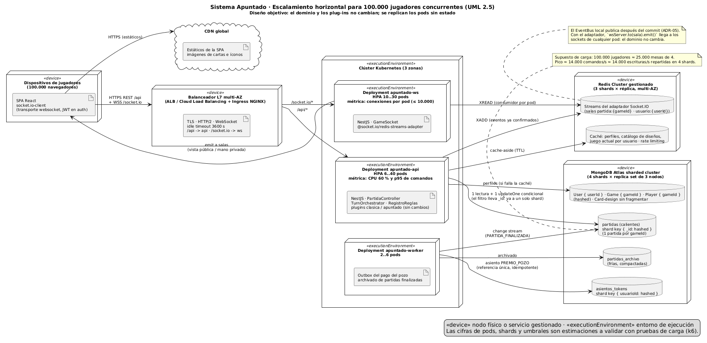

# Capítulo 5. Retrospectiva arquitectural, escalabilidad y lecciones aprendidas

Entregable 3, MVP del Sistema Apuntado. Rama `feature/entregable-3-mvp`.

Este capítulo mira hacia atrás y hacia adelante:

- **Hacia atrás:** analiza las decisiones del proyecto con las dos leyes de la arquitectura de
  software de Richards & Ford (2025), consolida el efecto de los ADR-01 a ADR-05 y contrasta los
  riesgos del *risk storming* del Entregable 2 con lo que el MVP mitigó y comprobó.
- **Hacia adelante:** propone cómo llevar la misma arquitectura a 100.000 jugadores concurrentes.

Cada afirmación sobre el MVP remite a código, pruebas o métricas de esta rama. Cuando algo **no**
se hizo, se dice explícitamente.

---

## 5.1 Las leyes de la arquitectura aplicadas al proyecto

### 5.1.1 Primera ley: "Todo en arquitectura es un *trade-off*"

Richards & Ford sostienen que, si un arquitecto cree haber encontrado algo que no implica un
compromiso, probablemente todavía no lo identificó. Las tres decisiones de mayor peso del
proyecto se analizan con esa lente: qué se ganó, qué se pagó y cómo se mide.

#### a) Microkernel dentro de un monolito modular, frente a un monolito modular "plano"

| | Monolito modular plano (reglas dentro del orquestador) | **Microkernel dentro del monolito modular (elegido, ADR-03)** |
|---|---|---|
| Agregar una modalidad | Editar el orquestador, los servicios de puntaje y sus pruebas | Un paquete en `backend/plugins/<id>/` y una línea en la raíz de composición |
| Probar las reglas | Requiere el contexto de NestJS | Funciones puras: las suites del evaluador, del contrato, de los casos borde y de los dos plug-ins corren sin NestJS ni base de datos (FF-05 lo garantiza) |
| Piezas que mantener | Menos | Contrato versionado (`VERSION_CONTRATO`), registro con validación semver y prueba de humo, raíz de composición |
| Costo de un cambio incompatible del contrato | No aplica | Migrar todos los plug-ins a la vez |

**Qué se ganó (medido).** El contrato `src/reglas/contrato` es el componente más estable y abstracto
del backend: I = 0, A = 0,91, D = 0,09. Los plug-ins tienen Ca = 1, y ese único dependiente es la
raíz de composición (capítulo 4, §4.2.4). FF-02 lo verifica en cada PR: al importar un plug-in
desde `aplicacion/partida`, el pipeline falla (§4.3.3).

**Qué se pagó.** Más indirección, y una decisión consciente dentro de la decisión. El ADR-03
proponía cargar los plug-ins con un manifiesto JSON e `import()` dinámico. El MVP los registra
**de forma estática** en `ReglasPluginsModule`: con solo dos modalidades, la carga dinámica
añadía complejidad (rutas en tiempo de ejecución, tipado débil, pruebas de arranque) sin un
beneficio inmediato. El precio es que agregar una modalidad exige recompilar la raíz de
composición, aunque el orquestador siga sin cambios.

#### b) Transacciones ACID en MongoDB, frente a consistencia eventual

| Operación | Mecanismo en el MVP | Por qué |
|---|---|---|
| Robar, descartar, tocar, cerrar sin terminar la partida | **Una** escritura atómica condicional sobre el documento `partidas` (`version`, turno, `idComando`) | El agregado es la frontera de consistencia (ADR-04): un solo documento no necesita transacción |
| Iniciar la partida (cobro de apuestas) | Transacción `snapshot` / `majority` sobre `User`, `asientos_tokens`, `partidas` y `Game` | Cruza agregados y mueve dinero: no puede quedar a medias |
| Terminar la partida (pago del pozo) | La escritura final y `pagarPozo()` en la misma transacción | Ídem; `referencia` única en `asientos_tokens` impide pagar dos veces |
| Notificar a los clientes | Evento local **después** del *commit*, sin *outbox* | Si el evento se pierde, el cliente lo recupera por salto de versión (ADR-05) |

**Qué se ganó.** Ninguna liquidación parcial (R02) y ningún doble pago (R03). Lo comprueban las 8
pruebas e2e de `backend/test/close-concurrency.e2e-spec.ts` sobre un *replica set* real: dos
cierres simultáneos producen exactamente un ganador y un solo pago, y dos inicios simultáneos
cobran las apuestas una sola vez.

**Qué se pagó.**

- MongoDB tiene que correr como *replica set* incluso en desarrollo (un nodo con `--replSet rs0`).
- Las transacciones son más lentas que una escritura simple, y por eso se limitan a dos momentos
  por partida.
- El *trade-off* contrario se aceptó en las notificaciones: un evento puede perderse si el proceso
  cae justo después del *commit*. Se prefirió la simplicidad sobre un *outbox* transaccional porque
  la fuente de verdad es la base y el cliente sabe recuperarse.
- **El *trade-off* se invierte al escalar** (§5.4.4). Con la base fragmentada (*sharding*), la
  transacción del pago del pozo pasaría a ser distribuida entre *shards*. El diseño propuesto la
  cambia por consistencia eventual con un *outbox*: se gana *throughput* y se acepta que el saldo
  del ganador se actualice con unos segundos de retraso.

#### c) WebSockets con salas privadas, frente a *broadcast* público

| | *Broadcast* a la sala (prototipo) | **Sala pública + sala privada por usuario (elegido, ADR-05)** |
|---|---|---|
| Fuga de información (R04) | `SHIFT_CHANGED` enviaba la mano del siguiente jugador a todos; `MATCH_STARTED`, el mazo completo | La sala `partida:{gameId}` solo recibe la vista pública; `usuario:{userId}` solo la mano propia |
| Mensajes por comando | 1 | 1 por evento público + 1 por cada mano que cambió |
| Lógica en el servidor | Mínima | `planificarNotificaciones()` (función pura) decide qué va a cada sala |
| Verificación | Ninguna | `notificaciones-partida.spec.ts` revisa en profundidad que ningún mensaje público tenga `manos`, `mazo` ni `cartas` |

**Qué se pagó.** Más mensajes y más salas: cada conexión pertenece a dos salas y cada comando genera
varios envíos. Con un solo servidor esto no se nota. Con varios nodos, cada envío a una sala debe
viajar por el adaptador de Socket.IO (§5.4.2), así que esta decisión de seguridad tiene un costo
directo en la capacidad del bus de mensajes.

#### d) Otros *trade-offs* que aparecieron durante la construcción

- **Comandos por REST y notificaciones por WebSocket.** Los comandos pasan por
  `POST /api/matches/current/commands/*` y no por el socket. Esto da semántica HTTP clara (409 con
  `RONDA_YA_CERRADA`), idempotencia por `idComando` y pruebas e2e sencillas. El costo son dos
  canales y una petición HTTP por acción.
- **Sondeo cada 2 s en la sala de espera (fase 5).** Garantiza que la lista de jugadores converja
  aunque se pierda un evento (INC-02). Es un buen *trade-off* para decenas de usuarios y uno malo
  para cien mil (§5.4.6).
- **Índices de cartas en el contrato REST.** El backend identifica las cartas por su posición en la
  mano, que no es ambigua con doble baraja. El costo es que el cliente debe traducir sus
  intenciones a índices usando la mano de la misma versión.

### 5.1.2 Segunda ley: "El *por qué* es más importante que el *cómo*"

Richards & Ford advierten que un diagrama muestra **cómo** está hecho un sistema, pero no **por qué**
se eligió así. El proyecto lo comprobó en la práctica: varias veces el *cómo* de un ADR cambió durante
la implementación, y fue posible hacerlo sin perder la intención porque el *por qué* estaba escrito.

| ADR | Por qué (fuerza que la motivó) | Cómo se propuso | Cómo quedó en el MVP | ¿Se cumplió el por qué? |
|---|---|---|---|---|
| **ADR-01** Particionar por dominio | El prototipo caía en *Entity Trap*: `PlayerService` concentraba reparto, turnos, validación y puntaje, y había un ciclo entre 8 módulos | Módulos de dominio (`juego`, `reglas`, `puntaje`, ...) con `api/`, `aplicacion/`, `dominio/`, `infraestructura/` | Capas transversales `dominio/`, `aplicacion/`, `reglas/` y `database/` con registros propios (DIP), conservando los controladores del prototipo | **Sí:** FF-03 sin ciclos en modo estricto, `baseline.json` vacío y el motor probado sin framework. El cambio de forma quedó registrado en [ADR-06](adrs/ADR-06-organizacion-por-capas-de-src.md). |
| **ADR-02 / ADR-03** Reglas como plug-ins | Agregar una variante sin tocar el núcleo ni la persistencia | Manifiesto `reglas.plugins.json` + `import()` dinámico | Registro estático en la raíz de composición, validado al arrancar (semver, forma, prueba de humo) | **Sí, en el núcleo:** el orquestador no conoce ningún plug-in (Ca de los plug-ins = 1). **No, en la recompilación:** agregar una variante exige recompilar la raíz. |
| **ADR-04** Partida como agregado documental | Cerrar y liquidar de forma atómica, sin penalizaciones parciales (R02) ni dobles pagos (R03) | Documento `partidas` + bitácora `jugadas` (*bucket*) + libro `asientos_tokens` + validadores `$jsonSchema` | `partidas` y `asientos_tokens` con driver nativo, escritura condicional y transacciones en inicio y fin. La bitácora `jugadas` y la migración de `User`/`Game`/`Player` quedaron pendientes. | **Sí** para la atomicidad (8/8 e2e). La trazabilidad jugada a jugada todavía no existe. |
| **ADR-05** Comando síncrono + eventos después del *commit* | Nunca notificar algo que no ocurrió, y no filtrar cartas | `GameApiGateway` → interfaces → `IGameStateStore`; eventos `CartaRobada`, `TurnoCambiado`, ... | `PartidaController` → `TurnOrchestrator` → funciones puras → `PartidaRepository`; un solo `PartidaActualizadaEvent` con la lista de eventos de dominio | **Sí:** `turn-orchestrator.service.spec.ts` comprueba que no se publica nada si la escritura falla, y las vistas filtradas se prueban. `PresenceMonitor` (temporizadores) no se implementó. |

**La lección más concreta de la segunda ley** apareció en la fase 6. La regla de FF-02 "el núcleo no
conoce plug-ins" se había escrito sobre el *cómo* del Entregable 2: buscaba las carpetas `juego`,
`puntaje` y `sala`. Cuando el *cómo* cambió a capas, la regla siguió en verde sin revisar nada. Se
corrigió apuntándola a las carpetas reales y se comprobó con una mutación (capítulo 4, §4.3.3).
Una fitness function debe verificar el **por qué** (el núcleo no depende de las variantes), no un
detalle del **cómo** (el nombre de una carpeta).

---

## 5.2 Espectro de las decisiones arquitecturales (ADR-01 a ADR-05)

Richards & Ford (2025, cap. 21) consideran que una decisión es arquitectónicamente significativa
cuando afecta a la **estructura**, a las **características** (atributos de calidad), a las
**dependencias**, a las **interfaces** o a las **técnicas de construcción**. La tabla ubica cada ADR
en ese espectro.

| ADR | Estructura | Características | Dependencias | Interfaces | Técnicas de construcción | Evidencia en el MVP |
|---|---|---|---|---|---|---|
| **ADR-01** Monolito modular por dominio | Un solo *quantum*; capas `dominio` / `aplicacion` / `reglas` / `database` | Mantenibilidad, testabilidad, factibilidad | Sin ciclos; el dominio no depende de Mongoose (registros propios) | `aplicacion.module.ts` como frontera de los servicios | Refactor del prototipo guiado por fitness functions en modo trinquete | FF-01, FF-03 y FF-05 en verde en ambos modos |
| **ADR-02** Reglas como Strategy | Evaluador algorítmico en lugar de tablas | Corrección de las reglas (R01) | Los plug-ins solo dependen del contrato y del evaluador | `IHandEvaluator`, `PoliticaEscalera` | Oráculo de regresión: el evaluador acepta exactamente las 260 ternas y 299 cuartas de las tablas eliminadas | `evaluador-manos.spec.ts`, FF-04 (CC máxima 7 en el núcleo) |
| **ADR-03** Microkernel con registro | Núcleo + contrato + `plugins/clasica` y `plugins/apuntado` | Extensibilidad (Top 1) | Plug-ins con Ca = 1; contrato con I = 0 | `ReglaJuegoPlugin` v1.0.0 (6 operaciones puras) | Suite de contrato común (`plugins/contrato.spec.ts`), registro *fail fast* | FF-02 (con mutación verificada), `registro-reglas.spec.ts` |
| **ADR-04** MongoDB documental | Agregado `partidas`; libro `asientos_tokens` *append-only* | Integridad del puntaje y del dinero (R02, R03) | Replica set obligatorio | Escritura condicional `actualizarSiCoincide`; `UnidadDeTrabajo` | Validadores `$jsonSchema` estrictos aplicados por `mongo-init` | FF-06 (15 pruebas), e2e 8/8 |
| **ADR-05** Síncrono + eventos locales | `EventBus` en proceso; gateway que solo notifica | *Responsiveness*, seguridad (R04), recuperación (R07) | El orquestador no conoce Socket.IO | Salas `partida:{gameId}` y `usuario:{userId}`; versión en cada mensaje; `GET /api/matches/current` | Persistir antes de notificar; cliente que nunca retrocede de versión | `notificaciones-partida.spec.ts`, `turn-orchestrator.service.spec.ts`, Vitest 16/16 |

**Lectura de conjunto.** Las cinco decisiones se refuerzan entre sí:

- ADR-03 necesita reglas puras, y ADR-02 se las da.
- ADR-04 necesita que todo el cálculo ocurra antes de escribir, y ADR-05 lo impone con su ruta
  síncrona.
- ADR-05 puede publicar después del *commit* sin miedo porque ADR-04 deja un estado recuperable con
  `version`.

Si se quitara una de ellas, las otras perderían parte de su garantía.

---

## 5.3 Resolución del *risk storming* del Entregable 2

El *risk storming* del Entregable 2 (`diagramas/entregable-2/08-risk-storming-componentes.puml`)
consensuó 13 riesgos con una puntuación de impacto × probabilidad. La matriz muestra cómo quedó cada
uno en el MVP.

Siguiendo a Richards & Ford (2025, cap. 6), se distinguen dos tipos de verificación:

- **Fitness functions estructurales:** FF-01 a FF-06, que analizan el código sin ejecutarlo.
- **Fitness functions de comportamiento:** pruebas automatizadas que verifican una característica
  ejecutando el sistema, como la concurrencia o la ausencia de fugas.

| Riesgo (E2) | Puntaje | Mitigación en el MVP | Verificación automatizada | Estado |
|---|:---:|---|---|:---:|
| **R04** Fuga de información oculta por WSS | **9** | Salas pública y privada; vistas filtradas (`vistaPublica` solo lleva el tamaño de cada mano); los rivales nunca reciben cartas; barajado con `crypto.randomInt` | `notificaciones-partida.spec.ts` (inspección profunda de cada mensaje público) | ✅ Mitigado |
| **R03** Cierre o comando concurrente | 6 | Escritura condicional por `version` y turno; idempotencia con `idComando` (`$slice: -20`); `resolverConflicto` responde 409 `RONDA_YA_CERRADA` | `concurrencia-cierre.e2e-spec.ts`: dos cierres simultáneos, doble clic, reenvío, Apuntado y versión vieja (8/8) | ✅ Mitigado |
| **R02** Inconsistencia del marcador | 6 | Liquidación y desenlace calculados en memoria en el mismo comando; una sola escritura; se eliminó `updateLoserPlayers().then()` | e2e "Apuntado: una sola liquidación atómica"; `casos-borde.spec.ts` (101 exacto, -51 exacto) | ✅ Mitigado |
| **R01** Falla combinatoria del evaluador | 6 | Evaluador algorítmico con política de escalera | Oráculo 260/299 en `evaluador-manos.spec.ts`; casos borde A y B; **FF-04** (CC ≤ 10) | ✅ Mitigado |
| **R05** Contrato inestable entre núcleo y plug-ins | 6 | Contrato versionado; el registro valida semver, la forma y una prueba de humo, y no arranca si falla | **FF-02**, `plugins/contrato.spec.ts`, `registro-reglas.spec.ts` | ✅ Mitigado |
| **R11** Degradación estructural (ciclo de 8 módulos) | 6 | Refactor a capas con registros propios en `database/` | **FF-03** en modo estricto, `baseline.json` vacío; **FF-01**, **FF-05** | ✅ Mitigado |
| **R06** Plataforma sin WebSockets persistentes | 6 | Despliegue en Render Web Services (contenedor) y Nginx con `Upgrade` y `proxy_read_timeout 3600s` | Job `contenedores` de `ci.yml` (prueba de humo); validación en producción del capítulo 3 | ✅ Mitigado |
| **R07** Desincronización al refrescar | 4 | `GET /api/matches/current`; el cliente nunca retrocede de versión y relee ante un salto o una reconexión | `partida.utils.test.ts` (Vitest: `compararVersion`, `debeRefrescar`) | ✅ Mitigado |
| **R09** Latencia por escritura por comando | 4 | Una lectura y una escritura por comando; transacción solo al iniciar y al terminar | Ninguna: no hay prueba de carga (el ADR-05 pedía k6 con 50 partidas) | ⚠️ Parcial |
| **R13** Crecimiento del documento (16 MB) | 2 | Mazo ≤ 104 cartas, `comandosRecientes` ≤ 20; el marcador crece una entrada por ronda | **FF-06** (el esquema rechaza manos de más de 11 cartas) | ✅ Bajo control |
| **R08** Abandono / temporizadores perdidos | 4 | Solo en la sala de espera (`DELETE /api/game/current`, fase 5). Los campos `conectado`, `desconectadoDesde` y `graciaDesconexionSeg` existen, pero **no hay temporizadores**: un jugador que abandona una partida en curso la bloquea | `game.service.leave-cancel.spec.ts` (solo la sala de espera) | ❌ Pendiente |
| **R12** Contraseñas SHA-256 sin sal | 6 | **No mitigado en el código.** `dominio/user/user-password.ts` sigue usando `SHA256()` de `crypto-js`. FF-06 solo valida el esquema de la colección `usuarios`, que el MVP todavía no usa (el backend lee `User` con Mongoose) | FF-06 (sobre el esquema, no sobre el código) | ❌ Pendiente |
| **R10** Fraude en recargas manuales | 6 | Las recargas no forman parte del MVP: el libro de tokens prevé el tipo `RECARGA`, pero no hay flujo que lo use | — | ➖ Fuera de alcance |

**Balance.** Los seis riesgos de mayor puntaje que afectan al juego (R01 a R05 y R11) están
mitigados y tienen una verificación automatizada que corre en cada PR. Quedan tres puntos abiertos,
y conviene decirlo en la sustentación antes de que lo pregunten:

- **R12** es el más serio. Antes de un despliegue con usuarios reales hay que migrar a argon2id,
  rehashear la contraseña en el siguiente inicio de sesión y agregar una fitness function sobre
  `user-password.ts`, no solo sobre el esquema.
- **R08** limita la experiencia: una mesa abandonada queda bloqueada.
- **R09** no está medido. Las latencias del capítulo 3 son observaciones de una sesión, no una
  prueba de carga.

---

## 5.4 Diseño de escalabilidad para 100.000 jugadores concurrentes

### 5.4.1 Supuestos de carga

| Variable | Valor | Origen |
|---|---|---|
| Jugadores conectados | 100.000 | Requisito de esta sección |
| Mesas activas | ≈ 25.000 | Promedio de 4 jugadores por mesa (el juego admite de 2 a 6) |
| Duración de un turno | ≈ 11,2 s | Medición del capítulo 3 (T3) |
| Comandos por turno | 2 (robar + descartar) | Contrato REST |
| Comandos por segundo | 25.000 × 2 / 11,2 ≈ **4.500/s** en promedio, **≈ 14.000/s** en pico (× 3) | Cálculo |
| Mensajes de socket por comando | ≈ 5 (1 público a 4 sockets + 1 privado) | `planificarNotificaciones()` |
| Mensajes de socket por segundo | ≈ 22.500/s en promedio, ≈ 70.000/s en pico | Cálculo |
| Tamaño de una partida activa | ≈ 10 KB (mazo, 4 manos, marcador) | Estimación sobre el esquema |
| Datos calientes | 25.000 × 10 KB ≈ **250 MB** | Caben en la memoria del clúster |

Son estimaciones. Deben validarse con una prueba de carga (§5.4.7) antes de dimensionar la
infraestructura.

### 5.4.2 Arquitectura objetivo

Fuente: [`diagramas/entregable-3/04-escalabilidad-100k.puml`](../diagramas/entregable-3/04-escalabilidad-100k.puml).

**La pieza clave es que el backend ya es casi sin estado:**

- La sesión va en el JWT.
- `TurnOrchestrator` lee y escribe la base en cada comando y no guarda nada entre comandos.
- El registro de reglas es inmutable después del arranque.

El único estado en memoria que impide replicar el servidor son las **salas de Socket.IO**: hoy, si
el comando llega al pod A y el jugador está conectado al pod B, el mensaje no le llega. Por eso el
diseño se concentra ahí.

| Capa | Componente | Decisión |
|---|---|---|
| Borde | CDN | La SPA, las cartas y los íconos salen del CDN; el clúster solo atiende `/api` y `/socket.io` |
| Entrada | Balanceador L7 multi-AZ + Ingress NGINX | TLS, HTTP/2 y WebSocket; `idle timeout` ≥ 3600 s, como hoy `proxy_read_timeout` en `nginx.conf` |
| Tiempo real | Deployment `apuntado-ws` (10 a 30 pods) | Solo mantiene sockets y reenvía mensajes; escala por conexiones (≤ 10.000 por pod) |
| Comandos | Deployment `apuntado-api` (6 a 40 pods) | `PartidaController`, `TurnOrchestrator` y plug-ins **sin cambios**; escala por CPU y p95 |
| Trabajo diferido | Deployment `apuntado-worker` (2 a 6 pods) | Pago del pozo por *outbox* y archivado de partidas terminadas |
| Bus | Redis Cluster (streams) | Adaptador de Socket.IO entre pods |
| Caché | Redis Cluster | Perfiles, catálogo de diseños, juego actual por usuario y *rate limiting* |
| Datos | MongoDB Atlas *sharded* (4 *shards* × 3 nodos) | `partidas`, `asientos_tokens`, `User`, `Game` y `Player` fragmentadas |

Un primer paso más simple es mantener un solo *deployment* (API y WebSocket en el mismo pod) con el
adaptador de Redis. Separar `apuntado-ws` de `apuntado-api` permite escalar cada uno con su propia
métrica, y conviene hacerlo cuando la prueba de carga muestre que se saturan por razones distintas.

### 5.4.3 Socket.IO multinodo con Redis

1. **Adaptador.** Se usa `@socket.io/redis-streams-adapter` en lugar de `@socket.io/redis-adapter`
   (pub/sub). Con *streams*, un pod que se reinicia retoma los mensajes desde su último *offset*, lo
   que permite la *connection state recovery* de Socket.IO. Con pub/sub, los mensajes enviados
   mientras el pod está caído se pierden.
2. **Cambio en el código.** Un `IoAdapter` personalizado en `main.ts` que llama a
   `server.adapter(createAdapter(redis))`. `GameSocket.notificarPartida()` sigue haciendo
   `wsServer.to(sala).emit()`; el adaptador lo entrega a los sockets de cualquier pod. **El dominio,
   el orquestador y `planificarNotificaciones()` no cambian**: ADR-05 ya había dejado prevista esta
   extensión (punto 4 de su decisión).
3. **Transporte y autenticación.** Hoy el JWT viaja en `extraHeaders.authorization`, y el navegador
   solo puede enviar cabeceras propias en el *long-polling* inicial. Con varios pods, el *polling*
   exige sesiones pegajosas (*sticky sessions*) en el balanceador. La propuesta es forzar
   `transports: ['websocket']` y enviar el token en `auth: { token }`. Requiere cambiar
   `jwt.socket.strategy.ts` para leer `handshake.auth.token`, y elimina la necesidad de afinidad.
4. **Capacidad del bus.** En el pico de ≈ 70.000 mensajes/s, cada envío a una sala se publica una
   vez en el *stream* y lo leen los pods `apuntado-ws`. Tres *shards* de Redis con réplica dan margen
   para ese volumen, pero es el primer número que la prueba de carga debe confirmar.

### 5.4.4 Fragmentación de MongoDB y aislamiento de las sesiones de juego

| Colección | Clave de *shard* | Razón |
|---|---|---|
| `partidas` | `{ _id: "hashed" }` | Cada sala (`gameId`) tiene exactamente una partida (`Game.partidaId`): fragmentar por `_id` equivale a fragmentar por `gameId`. El filtro de `actualizarSiCoincide` ya incluye `_id`, así que cada comando va a **un solo shard** y no hay que cambiar la consulta. El *hash* reparte las 25.000 mesas sin puntos calientes. |
| `Game` | `{ gameId: "hashed" }` | Todas las búsquedas de la sala son por `gameId` |
| `Player` | `{ gameId: "hashed" }` | La sala de espera consulta por `gameId`. La búsqueda por `userId` (`getActiveByUserId`) se atiende con la caché "juego actual por usuario". |
| `User` | `{ userId: "hashed" }` | Perfil y saldo por usuario |
| `asientos_tokens` | `{ usuarioId: "hashed" }` | En una colección fragmentada, un índice único debe empezar por la clave de *shard*: `referencia` pasa a `{ usuarioId, referencia }`. La idempotencia se conserva porque cada referencia ya identifica la partida (y el usuario, en las apuestas), y el premio de una partida siempre va al mismo ganador. |
| `Card-design` | Sin fragmentar | Catálogo pequeño y casi inmutable, servido desde la caché |

**Aislamiento de las sesiones efímeras.** Una partida solo está "caliente" mientras se juega. El
diseño separa dos colecciones:

- `partidas` solo contiene partidas en curso. Eso mantiene los datos calientes en ≈ 250 MB, dentro
  de la memoria de los *shards*.
- Al llegar `PARTIDA_FINALIZADA`, el *worker* (escuchando un *change stream*) copia una versión
  compacta (sin mazo ni manos, con el marcador y el pozo) a `partidas_archivo` y borra la original.

**El *trade-off* de la sección 5.1.1-b se invierte.** En el MVP, `pagarPozo()` actualiza
`partidas`, `asientos_tokens`, `User`, `Game` y `Player` en una transacción. Con *sharding*, esos
documentos viven en *shards* distintos y la transacción se vuelve distribuida (*two-phase commit*):
más lenta y con más abortos por conflicto. La propuesta es un *outbox* transaccional:

1. El comando que termina la partida escribe en **un solo documento** `estado: FINALIZADA` y
   `pagoPendiente: { ganadorId, monto }`. Es atómico y va a un solo *shard*.
2. El *worker* procesa el *change stream* e inserta el asiento `PREMIO_POZO` con la referencia
   única que ya existe (`PREMIO_POZO:{partidaId}`). Así el pago es **idempotente**: si el *worker*
   falla y reintenta, el índice único impide pagar dos veces.
3. Se pierde la consistencia inmediata del saldo (el ganador lo ve con unos segundos de retraso) a
   cambio de que el comando de cierre no espere una transacción entre *shards*.

El cobro de apuestas al iniciar conserva la transacción distribuida: ocurre una vez por partida y
no puede quedar a medias. Con 25.000 mesas simultáneas y partidas de unos 15 minutos son
≈ 100.000 inicios por hora, unos 28 por segundo: un volumen que una transacción distribuida
soporta.

### 5.4.5 Caché con Redis

| Dato | Hoy | Con caché | Invalidación |
|---|---|---|---|
| Juego actual del usuario | `GameGuard` llama a `getNotFinishedByPlayer` en **cada** comando y en cada conexión de socket | Clave `juego:{userId}` → `{gameId, partidaId}` | Al unirse, salir, cancelar o terminar la partida |
| Perfil del usuario (nombre, ícono, diseño) | Lectura de `User` en varias pantallas | Clave `usuario:{userId}`, TTL 60 s | Al cambiar ícono, diseño o saldo |
| Catálogo de diseños de carta | Lectura de `Card-design` | Clave `disenos:activos`, TTL 1 h | Al publicar un diseño |
| *Rate limiting* por usuario | No existe | Contador con ventana deslizante | Automática |

La caché del juego actual es la de mayor efecto: hoy cada uno de los ≈ 14.000 comandos por segundo
haría una consulta adicional solo para autorizar. El estado de la partida **no** se guarda en
Redis: la fuente de verdad sigue siendo MongoDB, porque ahí están el pozo y los tokens, y la
escritura condicional por versión ya resuelve la concurrencia.

### 5.4.6 Topología, autoescalado y cambios previos obligatorios

**Kubernetes:**

- Tres zonas de disponibilidad.
- `HorizontalPodAutoscaler` por *deployment*: conexiones activas para `apuntado-ws` (métrica
  personalizada); CPU y p95 de comandos para `apuntado-api`.
- `PodDisruptionBudget` y *graceful shutdown*: al bajar un pod se dejan de aceptar conexiones y los
  clientes se reconectan a otro. El cliente actual ya relee el estado al reconectarse.
- *Readiness probe* sobre un endpoint que compruebe MongoDB y Redis. Hoy el *healthcheck* usa
  `/docs`, que no verifica dependencias.

**Cambios que deben hacerse antes de escalar.** Funcionan para el MVP, pero no para 100.000 usuarios:

1. **Sondeo de la sala de espera.** Hoy es cada 2 s (fase 5). Con 10.000 usuarios esperando serían
   5.000 peticiones por segundo solo para refrescar listas. Debe pasar a depender de los eventos del
   socket, con un sondeo de respaldo cada 15 a 30 s con *backoff*.
2. **Autenticación del socket** con `auth: { token }` y transporte solo WebSocket (§5.4.3).
3. **Temporizadores de turno (R08).** A esta escala, una mesa abandonada consume recursos sin fin.
   Se propone un plazo persistido en `rondaActual.turno.venceEn`, con un índice, y que el *worker*
   ejecute el turno automático.
4. **R12**, antes de abrir el registro a usuarios reales.

### 5.4.7 Cómo se validaría

- **Prueba de carga con k6.** Un escenario combinado: 100.000 sockets, 25.000 mesas simuladas y
  comandos con la cadencia medida en el capítulo 3. Se mide el p95 del comando (RNF-07: ≤ 300 ms),
  el p95 de propagación (RNF-09: ≤ 500 ms) y la tasa de respuestas 409.
- **Fitness function holística nueva.** "p95 de comandos ≤ 300 ms a 14.000 comandos/s", ejecutada
  en un entorno de *staging* antes de cada versión mayor.
- **Prueba de caos.** Matar un pod de `apuntado-ws` en medio de una partida y comprobar que ningún
  cliente pierde el estado: se reconecta, relee `GET /api/matches/current` y continúa.

**Lo que no cambia.** El dominio (`comandos-partida.ts`), el contrato, los dos plug-ins, la escritura
condicional y las vistas filtradas se mantienen intactos en todo el plan. Esa es la prueba final de
que las decisiones de los ADR-03 a ADR-05 separaron lo que varía (infraestructura, escala,
modalidades) de lo que debe permanecer estable (las reglas y su consistencia).

---

## 5.5 Lecciones aprendidas

1. **Las fitness functions deben revisarse a sí mismas.** FF-02 pasó en vacío después del refactor.
   Una prueba de mutación sencilla lo habría detectado antes. Cada fitness function nueva debería
   tener una meta-prueba sobre el código **real**, no solo sobre los *fixtures*.
2. **Medir cambia las conversaciones.** La métrica de complejidad ciclomática detectó `leaveOrCancel`
   (CC 13) en cuanto se publicó, y el equipo la bajó a 6 con pruebas en la misma fase. Sin el número,
   habría sido una opinión.
3. **El agregado documental simplificó la concurrencia.** Que todo el estado de la partida sea un
   documento convirtió el problema más difícil del juego (dos cierres simultáneos) en una sola
   escritura condicional, que se puede probar con 8 casos e2e.
4. **La validación con usuarios encontró lo que las pruebas no buscaban.** Los dos incidentes graves
   del capítulo 3 (usuario bloqueado y jugadores duplicados) estaban en el ciclo de vida de la sala
   de espera, fuera del núcleo que más se había probado.
5. **Documentar el porqué hizo baratos los cambios de forma.** El MVP se apartó del *cómo* de tres
   ADR (capas en lugar de módulos, registro estático, sin bitácora) y no perdió ninguna intención,
   porque cada una tenía una verificación. Las desviaciones deben quedar registradas: la
   organización por capas quedó en el ADR-06, escrito después de los hechos y al cierre del E3.
6. **Lo pendiente también es arquitectura.** R12 (contraseñas) y R08 (abandono) no son detalles de
   implementación: son riesgos de seguridad y de disponibilidad que el *risk storming* ya había
   puntuado en 6 y 4.

## Referencias

- Richards, M., & Ford, N. (2025). *Fundamentals of Software Architecture* (2.ª ed.). O'Reilly.
  Cap. 1 (leyes de la arquitectura), cap. 6 (fitness functions), cap. 21 (decisiones
  arquitectónicas), cap. 22 (análisis de riesgos).
- Socket.IO. *Redis Streams adapter* y *Connection state recovery*. https://socket.io/docs/v4/
- MongoDB. *Sharding* y *Choose a Shard Key*. https://www.mongodb.com/docs/manual/sharding/
